# Portable RPG Refactoring Design

## 1. 目的

現在のゲームは Arduino / Raspberry Pi Pico W 上で動作するRPGとして機能しているが、主要な処理の多くが単一の `.ino` ファイルに集中している。

今回のリファクタリングでは、既存のゲーム仕様や挙動を維持したまま、以下を目標とする。

- クラスごとの責務を明確にする
- ゲームロジックと描画処理を分離する
- ゲームデータとハードウェア依存処理を分離する
- 巨大な万能クラスを機能単位に分解する
- IDベースの定義データを Catalog に集約する
- 保存処理を `SaveManager` に一元化する
- `.ino` を Arduino のエントリポイントだけに近づける
- 各クラスを `.h / .cpp` へ段階的に分離する
- 第三者がコードを追いやすい構造にする
- 各機能をできるだけ独立してテスト・修正できる構造にする

---

# 2. 基本設計方針

## 2.1 ゲームロジックはハードウェアを知らない

以下のようなゲームロジック側のクラスは、原則として LCD、SDカード、GPIO、DAC などを直接操作しない。

```text
Map
CharacterState
Item
Skill
Inventory
Party

Exploration
FieldEventHandler
FloorManager
EncounterManager
Battle

ItemUseSystem
SkillEffectSystem
EvolutionSystem
CombatCalculator
```

ハードウェア依存処理は以下へ限定する。

```text
Graphic
Controller
AudioManager
Storage
ImageManager
Vibration
```

---

## 2.2 Game が各システムを接続する

異なるサブシステム同士を直接強く結合しない。

例えば `Battle` が直接 BGM を変更したり、`Menu` が直接 SD カードへ保存したりしない。

全体の状態遷移や、異なるシステム同士の接続は `Game` が担当する。

例：

```cpp
EncounterSpec spec =
    encounterManager.createEncounter(...);

startBattle(spec);
```

---

## 2.3 Renderer は読み取り専用

描画クラスはゲーム状態を変更しない。

例：

```cpp
battleRenderer.draw(
    const Battle& battle,
    const Player& player,
    const Party& party,
    Graphic& graphic,
    const ImageManager& images
);
```

Renderer から以下のような操作は行わない。

```cpp
hero.setHp(...);
inventory.addItem(...);
battle.changeState(...);
```

Renderer の責務は、

> 現在のゲーム状態を読み取り、画面へ表示すること

だけとする。

---

## 2.4 機能単位でカプセル化する

「Item クラスにアイテム関係を全部入れる」のではなく、

```text
データ
定義
ロジック
UI
Renderer
```

を1つの機能群として整理する。

例えばアイテム機能なら、

```text
Item
ItemCatalog
Inventory
ItemUseSystem
ItemMenu
ItemRenderer
```

という構成にする。

---

## 2.5 Catalog は static 参照を許可する

固定データを取得する Catalog は状態を持たないため、static 参照を許可する。

```cpp
Item item = ItemCatalog::get(itemId);
Skill skill = SkillCatalog::get(skillId);
EnemyData enemy = EnemyCatalog::get(enemyId);
```

以下のような依存注入は基本的に行わない。

```cpp
ItemCatalog catalog;
```

---

# 3. レイヤ構成

```text
ゲームデータ
    Item
    Skill
    CharacterState
    CoreStats
    Equipment
    SkillSet
    StatusEffects
    Progression

    Player
    Automaton
    Enemy

    Inventory
    Party
    AutomatonStorage

    Map
    WorldProgress
    BossProgress

定義データ
    ItemCatalog
    SkillCatalog
    CharacterCatalog
    EnemyCatalog
    EvolutionCatalog
    SkillLearnsetCatalog

ゲームルール
    ItemUseSystem
    SkillEffectSystem
    EvolutionSystem
    CharacterProgressionSystem
    CombatCalculator

ゲーム進行
    Exploration
    FieldEventHandler
    FloorManager
    EncounterManager
    Battle

UIロジック
    MenuFlow
    MainMenu
    ItemMenu
    SkillMenu
    EquipmentMenu
    EvolutionMenu
    ShopMenu
    InnMenu
    StorageMenu
    SettingsMenu

描画
    WorldRenderer
    BattleRenderer
    MainMenuRenderer
    ItemRenderer
    SkillRenderer
    EquipmentRenderer
    EvolutionRenderer
    ShopRenderer
    InnRenderer
    StorageRenderer
    SettingsRenderer
    TitleRenderer
    GameOverRenderer

ハードウェア / I/O
    Graphic
    Controller
    AudioManager
    Storage
    ImageManager
    Vibration

保存
    SaveManager

ユーザー設定
    Settings

ゲーム全体統括
    Game

プレイ中データの所有者
    GameSession
```

---

# 4. Item 系

## 4.1 Item

`Item` は1個のアイテムを表す値オブジェクトとする。

```cpp
class Item {
public:
    enum ItemType {
        ITEM_CONSUMABLE,
        ITEM_WEAPON,
        ITEM_ARMOR,
        ITEM_ACCESSORY,
        ITEM_MATERIAL,
        ITEM_IMPORTANT
    };

    ItemType type;
    int value;
    int price;
    int id;
    const char* name;
};
```

`Item` 自身は以下を担当しない。

```text
使用処理
所持数管理
装備処理
セーブ
ロード
UI
```

現在の規模では `Item.h` のみの header-only 構成でよい。

---

## 4.2 ItemCatalog

アイテムIDから定義データを取得する。

現在の、

```cpp
Item createItemById(int id);
```

を将来的に置き換える。

```cpp
class ItemCatalog {
public:
    static Item get(int id);
};
```

---

## 4.3 Inventory

所持しているアイテムと個数、所持金を管理する。

```text
items
money

addItem()
removeItem()
countItem()
```

Inventory は以下を担当しない。

```text
アイテム効果
装備処理
セーブ
ロード
画面描画
```

---

## 4.4 ItemUseSystem

消費アイテムの効果を担当する。

例：

```text
リペアキット
    → HP回復

TP回復アイテム
    → TP回復

状態異常回復アイテム
    → 状態異常解除

進化アイテム
    → EvolutionSystemへ処理を依頼
```

---

## 4.5 ItemMenu / ItemRenderer

### ItemMenu

担当：

```text
アイテム一覧の選択
使用アイテムの選択
対象キャラクターの選択
ItemUseSystemへの実行要求
```

### ItemRenderer

担当：

```text
アイテム一覧表示
個数表示
選択カーソル表示
対象選択画面表示
```

---

# 5. Skill 系

## 5.1 Skill

`Skill` はスキル定義データのみ保持する。

```cpp
struct Skill {
    int id;
    const char* name;
    int tpCost;
    int power;

    EffectType type;
    TargetScope scope;
    StatDependence dependence;
    Category category;
};
```

Skill 自身は実際の攻撃・回復・バフ処理を行わない。

---

## 5.2 SkillCatalog

IDからスキル定義を取得する。

```cpp
class SkillCatalog {
public:
    static Skill get(int id);
};
```

現在 Skill コンストラクタ内に存在する巨大な `switch(id)` は、最終的にこちらへ移す。

---

## 5.3 SkillSet

`SkillSet` はキャラクターが現在習得しているスキルを管理する。

Skill自体の固定定義は `SkillCatalog` が持つため、`SkillSet` は `Skill` オブジェクトそのものではなく、習得済みSkill IDだけを保持する。

```cpp
class SkillSet {
private:
    std::vector<int> learnedSkillIds;

public:
    bool has(int skillId) const;
    bool learn(int skillId);

    int count() const;
    int skillIdAt(int index) const;
};
```

つまり、

```text
SkillCatalog
    = Skillそのものの固定定義

SkillSet
    = このキャラクターが何を習得済みか
```

と分離する。

必要なSkillデータは、

```cpp
int skillId =
    skillSet.skillIdAt(index);

Skill skill =
    SkillCatalog::get(skillId);
```

のように取得する。

外部へ、

```cpp
std::vector<int>&
```

のような変更可能なコンテナ参照は公開しない。

---

### SkillLearnsetCatalog

「どのキャラクターが何LvでどのSkillを習得するか」という固定定義は `SkillLearnsetCatalog` が担当する。

```cpp
struct SkillLearningRule {
    int characterId;
    int level;
    int skillId;
};

class SkillLearnsetCatalog {
public:
    static ... getLearnableSkills(...);
};
```

責務：

```text
キャラクターID
習得レベル
習得Skill ID
```

のみを固定データとして管理する。

以下は担当しない。

```text
実際にSkillを習得させる
XPを増やす
レベルアップさせる
進化させる
```

実際の習得処理は `CharacterProgressionSystem` が `SkillSet` へ要求する。

---

## 5.4 SkillEffectSystem

スキルの実際の効果を担当する。

```text
ダメージ
回復
蘇生
バフ
デバフ
状態異常
状態異常回復
特殊効果
```

現在 `Status::AddBuff()` や `Status::AddDebuff()` が持っているスキルID別処理も、最終的にこちらへ移す。

---

## 5.5 SkillMenu / SkillRenderer

### SkillMenu

担当：

```text
習得可能スキル選択
必要アイテム確認
習得処理
```

### SkillRenderer

担当：

```text
スキル一覧表示
TPコスト表示
習得済み表示
習得可能状態表示
```

---

# 6. CharacterState

現在の `Status` は単なるステータスではなく、多数の責務を持っている。

現在含まれている主な責務：

```text
HP / TP
能力値
装備
状態異常
バフ
デバフ
習得スキル
経験値
レベル
進化
キャラクター名
キャラクター成長式
ダメージ計算
回復量計算
セーブ
ロード
UI用ポップアップ
```

これを最終的に `CharacterState` という集約クラスへ整理する。

```cpp
class CharacterState {
private:
    int characterId;

    CoreStats coreStats;
    Equipment equipment;
    SkillSet skillSet;
    StatusEffects statusEffects;
    Progression progression;

public:
    // 読み取り
    int id() const;

    const CoreStats& stats() const;
    const Equipment& equipmentState() const;
    const SkillSet& skills() const;
    const StatusEffects& effects() const;
    const Progression& progress() const;

    // 基本状態変更
    int takeDamage(int damage);
    void heal(int amount);
    void revive(int hpPercent);

    bool spendTP(int cost);
    void restoreTP(int amount);

    // 状態効果
    void applyEffect(...);
    void removeEffect(...);
    void clearBattleEffects();

    // 装備
    bool equip(...);
    void unequip(...);

    // Skill
    void learnSkill(int skillId);

    // 最終能力値
    int attack() const;
    int defense() const;
    int speed() const;
    int sense() const;
    int luck() const;
};
```

## 6.1 CharacterStateを集約ルートにする

外部コードがCharacterState内部のコンポーネントを自由に変更する構造にはしない。

避ける：

```cpp
character.stats().setHp(10);
character.effects().poisonTurns = 3;
character.equipment().weaponId = 100;
character.skills().push_back(...);
```

基本ルール：

```text
読み取り
    内部コンポーネントをconst参照で公開してよい

変更
    CharacterStateの意味のある操作を通す
```

したがって、

```cpp
CoreStats& stats();
Equipment& equipment();
SkillSet& skills();
StatusEffects& effects();
Progression& progress();
```

のような変更可能な非const getterは原則公開しない。

---

## 6.2 状態変更は意味のある操作として行う

例：

```cpp
character.takeDamage(50);
character.heal(30);

character.applyEffect(...);

character.equip(...);

character.learnSkill(skillId);
```

外部コードが内部データの保存形式や具体的フィールド配置を知る必要がない構造にする。

---

## 6.3 最終能力値の窓口

BattleやCombatCalculatorは、基礎能力値を直接使わない。

例えば最終Attackは、

```text
CoreStatsのAttack
+
Equipmentの補正
↓
StatusEffectsのBuff / Debuff
↓
最終Attack
```

として決定される。

そのため外部からは、

```cpp
character.attack();
character.defense();
character.speed();
character.sense();
character.luck();
```

を使用する。

概念的には、

```cpp
int CharacterState::attack() const {
    int value =
        coreStats.attack()
        + equipment.attackBonus();

    return statusEffects.applyAttackModifier(
        value
    );
}
```

となる。

BattleやCombatCalculatorは、装備やBuff計算の内部構造を知らない。

---

# 7. CoreStats

`CoreStats` はキャラクターの純粋な現在値・基礎能力値を管理する。

```text
HP
MaxHP

TP
MaxTP

Attack
Defense
Speed
Sense
Luck
```

例：

```cpp
class CoreStats {
private:
    int hp;
    int maxHp;

    int tp;
    int maxTp;

    int attack;
    int defense;
    int speed;
    int sense;
    int luck;
};
```

担当：

```text
HP / TPの現在値保持
基礎能力値保持

damage適用
heal
revive

TP消費
TP回復
```

以下は担当しない。

```text
装備品定義
装備補正ルール
Buff / Debuff
Skill ID別処理
成長テーブル
進化条件
セーブ形式
```

外部からCoreStatsを自由に書き換えず、基本的な状態変更は `CharacterState` を経由する。

---

# 8. Equipment

装備状態を管理する。

```text
weaponId
armorId
accessoryId
```

アイテム定義は `ItemCatalog` から取得する。

```cpp
Item weapon =
    ItemCatalog::get(weaponId);
```

Equipmentは、

```text
現在何を装備しているか
装備による能力補正
```

を担当する。

例：

```text
attackBonus()
defenseBonus()
speedBonus()
senseBonus()
luckBonus()
```

最終能力値そのものはEquipmentから直接取得せず、

```cpp
character.attack();
character.defense();
```

など `CharacterState` を窓口として取得する。

外部から、

```cpp
character.equipmentState().weaponId = 100;
```

のように直接変更しない。

装備変更は、

```cpp
character.equip(...);
character.unequip(...);
```

のような意味のある操作を通す。

UIは、

```text
EquipmentMenu
EquipmentRenderer
```

へ分離する。

---

# 9. StatusEffects

状態異常、Buff、Debuff、特殊戦闘状態をまとめて管理する。

対象：

```text
毒
猛毒
麻痺
沈黙
混乱

ATK buff
DEF buff
SPD buff
SEN buff
LCK buff
回避率 buff

ATK debuff
DEF debuff
SPD debuff
SEN debuff
LCK debuff

HP regen
TP regen

無敵
反射
挑発
かばう
2回行動
ステルス
ダメージ1化
ラストスタンド
カウンター
オートリバイブ
状態異常無効
属性耐性
行動不能
バリア
```

担当：

```text
現在付与されているEffect
残りターン
倍率

apply()
remove()
updateTurn()
clear()
clearBattleEffects()
```

読み取りAPIの例：

```cpp
bool isPoisoned() const;
bool isSilenced() const;

float attackMultiplier() const;
float defenseMultiplier() const;

int poisonTurns() const;
```

外部から、

```cpp
effects.poisonTurns = 5;
```

のように直接変更しない。

`SkillEffectSystem` も `StatusEffects` の内部値を直接操作せず、

```cpp
target.applyEffect(...);
```

のように `CharacterState` の公開APIを使用する。

---

# 10. Progression

`Progression` はXPとLevelの管理だけを担当する。

```cpp
class Progression {
private:
    int level = 1;
    int xp = 0;
    int nextLevelXp;

public:
    int level() const;
    int xp() const;
    int nextLevelXp() const;

    void addXP(int amount);
    bool canLevelUp() const;
    void levelUpOnce();
};
```

担当：

```text
現在Level
現在XP
次レベル必要XP

XP加算
レベルアップ可能判定
1レベル分の更新
```

以下は担当しない。

```text
能力値再計算
Skill習得
進化判定
進化実行
UI表示
```

一度に複数レベル上がる場合でも、現在のゲーム仕様を維持し、

```text
1レベル上昇
↓
進化判定
↓
能力値更新
↓
Skill習得確認
↓
次のレベル
```

と1レベルずつ処理する。

---

## 10.1 CharacterProgressionSystem

XP獲得から派生する処理全体の順序は `CharacterProgressionSystem` が統括する。

```cpp
class CharacterProgressionSystem {
public:
    ProgressionResult gainExperience(
        CharacterState& character,
        int xp
    );

    ProgressionResult tryItemEvolution(
        CharacterState& character,
        Inventory& inventory,
        int itemId
    );
};
```

責務：

```text
XP追加
レベルアップ処理

レベル進化判定

能力値再計算

Skill習得確認

アイテム進化処理

結果の集約
```

概念的な流れ：

```text
XP獲得
↓
ProgressionへXP追加
↓
Level Up可能？
↓ YES
1レベル上げる
↓
EvolutionSystemへレベル進化判定を依頼
↓
CharacterCatalogから新しい能力値を取得
↓
CharacterStateへ能力値を適用
↓
SkillLearnsetCatalogから習得Skillを確認
↓
SkillSetへ習得
↓
まだLevel Up可能？
```

`CharacterProgressionSystem` 自身は描画しない。

---

## 10.2 通常レベルアップと進化時の能力更新

既存仕様を維持する。

通常レベルアップ：

```text
MaxHPを再計算
現在HPはMaxHPの増加分だけ増加

MaxTP再計算
TP全回復

Attack / Defense / Speed /
Sense / Luck再計算
```

進化：

```text
characterId変更

新しいcharacterIdで
能力値を再計算

HP全回復
TP全回復

習得可能Skillを再確認
```

CharacterState側では、例えば、

```cpp
applyLevelUpStats(...);
applyEvolutionStats(...);
```

のように、意味の異なる更新処理を区別する。

具体的なメソッド名は実装時に調整してよい。

---

## 10.3 ProgressionResult

現在のような、

```text
0 = 変化なし
1 = Level Up
2 = 進化
```

という整数結果ではなく、意味を持つ結果型を使用する。

例：

```cpp
struct ProgressionResult {
    int oldLevel;
    int newLevel;

    bool evolved;

    int oldCharacterId;
    int newCharacterId;

    std::vector<int> learnedSkillIds;
};
```

UIやBattleはこの結果を読み、

```text
LEVEL UP

Skill習得

進化
```

などの表示を行う。

`CharacterProgressionSystem` 自身は画面表示を担当しない。

---

# 11. CharacterCatalog

キャラクターIDからキャラクター固有の固定定義を取得する。

担当：

```text
名前
基本能力値
能力値成長式
キャラクター種別
初期情報
```

現在Status内に存在する、

```text
updateName()

decide_MaxHP()
decide_MaxTP()
decide_Attack()
decide_Defense()
decide_Speed()
decide_Sense()
decide_Luck()
```

などの固定定義をこちらへ移す。

能力値取得の例：

```cpp
struct CoreStatsData {
    int maxHp;
    int maxTp;

    int attack;
    int defense;
    int speed;
    int sense;
    int luck;
};

class CharacterCatalog {
public:
    static CoreStatsData statsFor(
        int characterId,
        int level
    );
};
```

`CharacterCatalog` は以下を担当しない。

```text
現在HP
現在XP
習得済みSkill
Skill習得ルール
進化条件
```

Skill習得ルールは `SkillLearnsetCatalog`、進化条件は `EvolutionCatalog` が担当する。

---

# 12. Evolution

## 12.1 EvolutionCatalog

進化条件の固定定義を管理する。

```text
進化前Character ID
条件種類
条件値
進化後Character ID
```

例：

```text
39 + Lv10
    → 44

49 + Item10
    → 55
```

また、Skill習得確認に必要な進化系譜を取得できるようにする。

例：

```text
現在形態
↓
1つ前
↓
さらに1つ前
↓
初期形態
```

概念的には、

```cpp
getRules(...);
getLineage(...);
```

などを提供する。

---

## 12.2 EvolutionSystem

進化の判定と進化そのものを担当する。

担当：

```text
現在進化可能か

進化先Character IDの決定

Character IDの変更
```

以下は直接担当しない。

```text
XP処理
Level Up処理
能力成長テーブル
Skill習得ルール
UI表示
```

能力値再計算・Skill再確認など、進化後に必要な一連の処理は `CharacterProgressionSystem` が統括する。

---

## 12.3 レベル進化

```text
CharacterProgressionSystem
↓
EvolutionSystem
↓
EvolutionCatalog
↓
進化可能ならCharacter ID変更
↓
CharacterProgressionSystemへ結果を返す
↓
能力値再計算
↓
Skill再確認
```

---

## 12.4 アイテム進化

Menu自身が `EvolutionCatalog` を走査したり、CharacterStateを直接進化させたりしない。

概念的には、

```cpp
characterProgressionSystem
    .tryItemEvolution(
        character,
        inventory,
        itemId
    );
```

のようにゲームロジック側へ要求する。

処理：

```text
進化可能判定
↓
必要Item確認
↓
Item消費
↓
EvolutionSystemで進化
↓
能力値再計算
↓
Skill再確認
↓
ProgressionResultを返す
```

---

## 12.5 Skill習得と進化系譜

進化後のキャラクターも、進化前の形態で本来習得するSkillを保持できる現在仕様を維持する。

そのため、

```text
CharacterProgressionSystem
↓
EvolutionCatalogから進化系譜取得
↓
SkillLearnsetCatalogで
各形態の習得条件を確認
↓
SkillSet.learn(skillId)
```

とする。

SkillSet自身は進化系譜や習得レベルを知らない。

---

## 12.6 EvolutionMenu / EvolutionRenderer

### EvolutionMenu

担当：

```text
対象キャラクター選択
進化候補選択
進化実行要求
```

進化条件の判定そのものはゲームロジック側へ依頼する。

### EvolutionRenderer

担当：

```text
キャラクター一覧表示
進化条件表示
進化先表示
進化結果表示
```

---

# 13. CombatCalculator

戦闘中の計算だけを担当する。

担当：

```text
通常攻撃ダメージ計算
Skillダメージ計算
回復量計算
命中判定
クリティカル判定
```

`CombatCalculator` は `CharacterState` を変更しない。

入力は読み取り専用とする。

```cpp
DamageResult
CombatCalculator::calculateSkillDamage(
    const CharacterState& attacker,
    const CharacterState& target,
    const Skill& skill
);
```

結果型の例：

```cpp
struct DamageResult {
    bool hit;
    bool critical;
    int damage;
};
```

`CombatCalculator` は、

```text
命中したか
Criticalか
最終Damageはいくつか
```

を計算して返すだけとする。

HPを実際に変更するのはBattle側。

例：

```cpp
DamageResult result =
    CombatCalculator::calculateSkillDamage(
        attacker,
        target,
        skill
    );

if (result.hit) {
    target.takeDamage(
        result.damage
    );
}
```

これにより、

```text
CombatCalculator
    = 計算

CharacterState
    = 状態変更

Battle
    = 戦闘進行
```

を明確に分離する。

---

# 14. Enemy と戦闘キャラクターの構造

## 14.1 Player / Automaton / Enemy の関係

`Player`、`Automaton`、`Enemy` はすべて `CharacterState` を持つが、共通の親クラスは作らない。

継承ではなくコンポジションを使用する。

```cpp
class Player {
private:
    Position position;
    Direction direction;
    CharacterState state;
};

class Automaton {
private:
    CharacterState state;
};

class Enemy {
private:
    int enemyId;
    CharacterState state;
};
```

3者の役割は異なる。

```text
Player
    フィールド上の位置と向きを持つ
    GameSessionが所有する

Automaton
    PartyまたはAutomatonStorageに所属する
    Party / AutomatonStorageが所有する

Enemy
    1回のBattle中だけ存在する
    Battleが所有する
```

Battleで共通して必要になる情報は、親クラスを通して取得するのではなく、それぞれが持つ `CharacterState` を参照する。

---

## 14.2 EnemyData

敵の固定定義。

```cpp
struct EnemyData {
    int id;
    const char* name;

    int dropItemId;
    int dropRatePercent;
    int xpYield;
};
```

---

## 14.3 EnemyCatalog

敵IDから固定定義を取得する。

```cpp
class EnemyCatalog {
public:
    static const EnemyData& get(int id);
};
```

`EnemyCatalog` は、

```text
「敵ID 10とはどの敵か」
「名前は何か」
「何をドロップするか」
「経験値はいくつか」
```

といった固定定義のみを担当する。

実行中のEnemyインスタンスは所有しない。

---

## 14.4 Enemy

`Enemy` は現在の戦闘に存在する敵インスタンスを表す。

```cpp
class Enemy {
private:
    int enemyId;
    CharacterState state;
};
```

`Enemy` の所有者は `Battle` とする。

```cpp
class Battle {
private:
    std::vector<Enemy> enemies;
};
```

敵は戦闘開始時に生成され、戦闘終了時にまとめて破棄される。

```text
Encounter発生
↓
Battle開始
↓
Enemy生成
↓
戦闘
↓
Battle終了
↓
enemies.clear()
```

`Enemy` を `GameSession` に保存する必要はない。

---

# 15. Party

現在パーティーに参加している仲間だけを管理する。

```cpp
class Party {
private:
    std::vector<Automaton> activeMembers;
};
```

`Party` は格納している `Automaton` の所有者とする。

所有用の生ポインタは使用せず、最終設計では `std::vector<Automaton>` による値所有を基本とする。

担当：

```text
addMember()
removeMember()
swapMember()
member()
memberCount()
```

預かり所の仲間は `Party` には保持しない。

## Battle中のPartyに関するルール

BattleではParty内のメンバーをindexで参照するため、戦闘開始後から戦闘終了まではPartyの並び順を変更しない。

Battle中は禁止：

```text
Partyメンバーの並び替え
Partyメンバーの削除
Partyへの新規メンバー追加
PartyとAutomatonStorage間の移動
```

これにより、

```text
ALLY, 0
ALLY, 1
ALLY, 2
```

という戦闘中の参照先が変化しないことを保証する。

---

# 16. AutomatonStorage

預かり所に存在する仲間のみ管理する。

```cpp
class AutomatonStorage {
private:
    std::vector<Automaton> storedMembers;
};
```

`AutomatonStorage` は格納している `Automaton` の所有者とする。

所有用の生ポインタは使用せず、最終設計では `std::vector<Automaton>` による値所有を基本とする。

担当：

```text
deposit()
withdraw()
member()
memberCount()
```

## Partyとの所有権移動

`Automaton` はPartyとAutomatonStorageの両方に同時に存在しない。

```text
Party
    ↓ deposit

AutomatonStorage
```

または、

```text
AutomatonStorage
    ↓ withdraw

Party
```

という形で所有権を移動する。

コピーではなく、最終的にはmoveによって、

```text
CharacterState
レベル
XP
HP
TP
装備
習得スキル
```

などを維持したまま所有者を変更する。

概念的には、

```cpp
Automaton automaton =
    storage.take(index);

party.addMember(
    std::move(automaton)
);
```

のような処理になる。

実際のAPI形状は実装段階で決定する。

預かり所UIは、

```text
StorageMenu
StorageRenderer
```

が担当する。

---

# 17. EncounterManager

`EncounterManager` はEncounter機能全体を担当する。

現在別クラスとして存在する `Encounter` の歩数カウント・発生判定も、最終的には `EncounterManager` へ統合する。

## 17.1 担当

```text
歩数カウント

ランダムEncounter発生判定

敵数決定

敵ID決定

敵Level決定

Rare Enemy抽選

Boss Encounter生成
```

以下は担当しない。

```text
Enemyインスタンス所有

Battle進行

画像ロード

BGM再生

GameState変更
```

---

## 17.2 BattleKind

戦闘の種類は生のBGM IDではなく意味的な値で表す。

```cpp
enum class BattleKind {
    NORMAL,
    BOSS,
    FINAL_BOSS
};
```

`BattleKind` は、

```text
通常戦闘
Boss戦
Final Boss戦
```

というゲーム上の意味だけを表す。

BGM番号は知らない。

---

## 17.3 EnemySpawnSpec

Enemy1体分の出現情報。

```cpp
struct EnemySpawnSpec {
    int enemyId;
    int level;
};
```

---

## 17.4 EncounterSpec

```cpp
struct EncounterSpec {
    std::vector<EnemySpawnSpec> enemies;
    BattleKind kind;
};
```

以前の案にあった、

```text
bool isBoss
int bgmTrack
```

は持たせない。

`BattleKind` からBoss戦かどうかは判定できるため、`isBoss` は不要。

BGM IDはAudio側の責務なので `EncounterSpec` に含めない。

---

## 17.5 ランダムEncounter

概念的には、

```cpp
class EncounterManager {
private:
    int stepCounter = 0;

public:
    EncounterCheckResult onStep(...);

    EncounterSpec createBossEncounter(
        ...
    );

private:
    bool shouldEncounter();

    EncounterSpec createNormalEncounter(
        ...
    );
};
```

とする。

GameはPlayerが移動した場合にだけ、

```cpp
EncounterCheckResult result =
    encounterManager.onStep(...);
```

を呼ぶ。

Encounterが発生した場合だけ `EncounterSpec` を返す。

---

## 17.6 通常Encounterの流れ

```text
Exploration
↓
moved = true
Eventなし
↓
Game
↓
EncounterManager.onStep()
↓
Encounter発生判定
↓
Enemy編成決定
↓
EncounterSpec
↓
Game
↓
Battle開始
```

TownやBossRoomなど、

```text
そもそもランダムEncounterしてよい場所か
```

の判定も `EncounterManager` 側へまとめる。

Game側へEncounter条件をばらまかない。

---

## 17.7 Boss Encounter

Boss Eventから直接Battleを生成しない。

```text
Boss Event
↓
Game
↓
EncounterManager.createBossEncounter()
↓
EncounterSpec
↓
Game
↓
Battle
```

`EncounterManager` はBoss IDやEnemy編成を決めるが、Battle開始やBGM再生は行わない。

---

# 18. Battle

`Battle` は戦闘ルールと、1回の戦闘にだけ存在するデータを管理する。

## BattleKind

Battleは現在の戦闘種別を保持してよい。

```cpp
BattleKind battleKind;
```

これは、

```text
逃走可能か
Boss戦として扱うか
戦闘終了結果をどう返すか
```

などの戦闘ルールに使用する。

ただしBattleは、

```text
NORMAL → BGM 2
BOSS → BGM 3
FINAL_BOSS → BGM 4
```

のようなAudio上の対応関係を知らない。

---

## 18.1 Battleが所有するもの

Battleは戦闘中のEnemyを所有する。

```cpp
class Battle {
private:
    std::vector<Enemy> enemies;
    std::vector<BattleAction> actions;
};
```

EnemyはBattle開始時に生成する。

```cpp
void Battle::start(
    const EncounterSpec& spec
) {
    enemies.clear();

    for (const auto& spawn : spec.enemies) {
        enemies.emplace_back(
            spawn.enemyId,
            spawn.level
        );
    }
}
```

戦闘終了時に、

```cpp
enemies.clear();
```

して破棄する。

EnemyはGameSessionには含めない。

---

## 18.2 CombatantRef

BattleActionでは、Player、Automaton、Enemyへの長寿命の生ポインタを保持しない。

戦闘参加者は `CombatantRef` で識別する。

```cpp
enum class CombatantSide {
    PLAYER,
    ALLY,
    ENEMY
};

struct CombatantRef {
    CombatantSide side;
    int index;
};
```

例：

```cpp
CombatantRef {
    CombatantSide::PLAYER,
    0
};
```

は主人公。

```cpp
CombatantRef {
    CombatantSide::ALLY,
    1
};
```

はPartyの2体目。

```cpp
CombatantRef {
    CombatantSide::ENEMY,
    2
};
```

はBattle内の3体目のEnemyを表す。

Playerのindexは常に0とする。

---

## 18.3 BattleAction

BattleActionはメモリアドレスではなく `CombatantRef` を保持する。

```cpp
struct BattleAction {
    CombatantRef actor;
    CombatantRef target;

    ActionType type;
    int skillId;
};
```

例：

```cpp
BattleAction {
    actor = {
        CombatantSide::ALLY,
        1
    },

    target = {
        CombatantSide::ENEMY,
        0
    },

    type = ActionType::SKILL,
    skillId = 80
};
```

複数対象・全体対象スキルでは、実際の対象範囲は `Skill` の `TargetScope` に従って解決する。

---

## 18.4 戦闘参加者の解決

実際に攻撃や回復を実行する瞬間だけ、`CombatantRef` から `CharacterState` を取得する。

概念的には、

```cpp
CharacterState* Battle::resolveCombatant(
    CombatantRef ref,
    Player& player,
    Party& party
);
```

とする。

処理：

```cpp
switch (ref.side) {
    case CombatantSide::PLAYER:
        return &player.state();

    case CombatantSide::ALLY:
        return &party.member(ref.index).state();

    case CombatantSide::ENEMY:
        return &enemies[ref.index].state();
}
```

ここで取得するポインタ・参照は、その処理中だけ使用する非所有参照とする。

`BattleAction` や長寿命オブジェクトには保存しない。

---

## 18.5 Battle中のindex安定性

`CombatantRef` がindexを使用するため、戦闘中は各コンテナのindexを変化させない。

Partyについては禁止：

```text
メンバー削除
並び替え
追加
Storageとの移動
```

Enemyについても、戦闘途中で `erase()` しない。

敵が戦闘不能になっても、

```text
Enemy[0] DEAD
Enemy[1] ALIVE
Enemy[2] ALIVE
```

のように要素自体は残す。

禁止：

```cpp
enemies.erase(...);
```

戦闘終了時にまとめて、

```cpp
enemies.clear();
```

する。

これにより、

```text
ENEMY, 2
```

が戦闘途中で別のEnemyを指すことを防ぐ。

増援などでEnemyが追加され、`std::vector` の内部メモリ位置が変化しても、BattleActionはindexだけを保持しているため影響を受けない。

---

## 18.6 Battleが知ってよいもの

```text
Player
Party
Enemy
CharacterState
Skill
BattleAction
CombatantRef
BattleState
EncounterSpec
```

---

## 18.7 Battleが知らないもの

```text
LCD
Graphic
SDカード
画像ファイル名
BGMファイル名
BGM再生処理
フロア別敵出現テーブル
AutomatonStorage
```

---

## 18.8 Battleの責務

```text
戦闘開始
Enemyインスタンス生成
行動順
コマンド
対象選択
敵AI
BattleAction生成
戦闘参加者解決
攻撃処理
スキル実行
状態異常処理
勝敗判定
戦闘終了
```

---

## 18.9 BattleResult

Battle終了時にGameStateやMap、BGMを直接変更しない。

戦闘結果をGameへ返す。

```cpp
enum class BattleOutcome {
    VICTORY,
    DEFEAT,
    ESCAPE
};

struct BattleResult {
    BattleOutcome outcome;
    BattleKind kind;
};
```

Battleの責務は、

> 戦闘がどのように終了したかを決定するところまで

とする。

以下はBattleでは行わない。

```text
GameState変更

BossProgress更新

Map再生成

Player再配置

Field BGMへの切り替え

GameOverへの遷移
```

これらは `BattleResult` を受け取った `Game` が各Subsystemへ依頼する。

---

# 19. BattleRenderer

戦闘画面の描画のみ担当する。

読み取るもの：

```text
Battle
Player
Party
ImageManager
```

使用する描画手段：

```text
Graphic
```

`BattleRenderer` は `GameSession` 全体を受け取らない。

必要なゲーム状態だけを読み取り専用で受け取る。

概念的には、

```cpp
void BattleRenderer::draw(
    const Battle& battle,
    const Player& player,
    const Party& party,
    const ImageManager& images,
    Graphic& graphic
);
```

とする。

---

## 19.1 画像はRAMから読むだけ

BattleRendererは画像ロードを行わない。

例：

```cpp
const uint16_t* image =
    images.enemyImage(index);
```

Player：

```cpp
const uint16_t* image =
    images.playerImage();
```

Automaton：

```cpp
const uint16_t* image =
    images.allyImage(index);
```

BattleRendererは以下を知らない。

```text
画像slot番号
画像file名
Storage
SDカード
sdLock
画像load処理
```

禁止：

```cpp
images.load(...);
images.prepareBattleImages(...);
storage.loadToBuffer(...);
```

Rendererは、

> すでにRAMへ準備されている画像を読み取って描画するだけ

とする。

`BattleRenderer` は `Battle`、`Player`、`Party`、`CharacterState`、`ImageManager` を変更しない。

---

# 20. Exploration

フィールド上のPlayer操作と、フィールド上で起きる出来事の検出を担当する。

担当：

```text
Player移動

方向変更

壁判定

Mapとの衝突判定

Field Event検出

移動したかどうかの判定
```

実際のEvent処理そのものは担当しない。

---

## 20.1 FieldEvent

フィールド上で検出されたEventを表す。

```cpp
enum class FieldEventType {
    NONE,

    TREASURE,
    STAIR_UP,
    STAIR_DOWN,

    AUTOMATON,

    INN,
    SHOP,
    STORAGE,

    BOSS_BATTLE
};

struct FieldEvent {
    FieldEventType type;

    int tileX;
    int tileY;
};
```

---

## 20.2 ExplorationResult

ExplorationはGameStateを直接変更せず、結果をGameへ返す。

```cpp
struct ExplorationResult {
    bool moved;

    bool hasEvent;
    FieldEvent event;
};
```

概念的な流れ：

```text
Controller
↓
Exploration
↓
Player / Map
↓
ExplorationResult
↓
Game
```

---

## 20.3 Event検出

例えば宝箱の前でAを押した場合、

```text
TREASURE
tileX = 8
tileY = 12
```

という `FieldEvent` を返す。

Exploration自身は、

```cpp
state = GameState::EVENT;
```

とはしない。

また、

```cpp
inventory.addItem(...);
```

のようなEvent実行もしない。

---

## 20.4 Controllerとの境界

`Controller` は物理入力だけを担当する。

以下は `Controller` から `Exploration` へ移す。

```text
Player移動

方向変更

壁判定

Event tile判定
```

理想的な流れ：

```text
物理Button
↓
Controller
↓
Exploration
↓
Player / Map
```

---

# 21. Controller

物理ボタン入力のみ担当する。

担当：

```text
pressed()
pressedDebounced()
```

担当しないもの：

```text
主人公移動
壁判定
イベント判定
ゲーム状態変更
```

理想的な流れ：

```text
物理ボタン
↓
Controller
↓
Exploration
↓
Player / Map
```

---

# 22. FieldEventHandler

フィールド上で検出された `FieldEvent` を解釈し、Event固有のゲームロジックを実行する。

`Manager` ではなく `Handler` とする。

理由は、

> Event一覧やObject群を管理するクラスではなく、発生したEventを処理するクラス

だからである。

---

## 22.1 FieldEventHandler

概念的には、

```cpp
class FieldEventHandler {
public:
    FieldEventResult handle(
        const FieldEvent& event,
        ...
    );

private:
    FieldEventResult handleTreasure(...);
    FieldEventResult handleAutomaton(...);
};
```

とする。

Eventごとに、

```text
TreasureEvent
StairEvent
ShopEvent
InnEvent
...
```

というクラスを大量に作ることは現段階では行わない。

Event種類ごとのprivate処理に分離するだけで十分とする。

---

## 22.2 FieldEventAction

Event処理後にGameへ要求する動作を意味的な値として返す。

```cpp
enum class FieldEventAction {
    NONE,

    RETURN_TO_FIELD,

    FLOOR_UP,
    FLOOR_DOWN,

    OPEN_SHOP,
    OPEN_INN,
    OPEN_STORAGE,

    START_BOSS_BATTLE
};

struct FieldEventResult {
    FieldEventAction action;
};
```

`FieldEventHandler` 自身はGameStateを変更しない。

---

## 22.3 Treasure

TreasureはEvent固有ロジックなので `FieldEventHandler` が処理してよい。

```text
Treasure tileをOPENにする
↓
中身抽選
↓
Inventoryへ追加
↓
RETURN_TO_FIELD
```

描画やMessage表示はEventロジック側へ入れない。

---

## 22.4 Automaton

Automaton Eventもフィールド上のゲームロジックとして処理する。

```text
MapからAutomaton情報取得
↓
Automaton生成
↓
PartyまたはAutomatonStorageへ加入
↓
Map tileを更新
↓
RETURN_TO_FIELD
```

具体的なParty / Storage所有権ルールは、すでに決定した所有権設計に従う。

---

## 22.5 Stair

階段Eventでは `WorldProgress.currentFloor` を直接変更しない。

```text
STAIR_UP
↓
FieldEventHandler
↓
FLOOR_UP
↓
Game
↓
FloorManager
```

```text
STAIR_DOWN
↓
FieldEventHandler
↓
FLOOR_DOWN
↓
Game
↓
FloorManager
```

とする。

---

## 22.6 Shop / Inn / Storage

FieldEventHandlerはMenuを直接起動しない。

```text
SHOP
↓
OPEN_SHOP

INN
↓
OPEN_INN

STORAGE
↓
OPEN_STORAGE
```

をGameへ返す。

Gameが、

```cpp
menuFlow.openShop();
```

などを呼ぶ。

依存：

```text
FieldEventHandler
×→ MenuFlow

Game
→ MenuFlow
```

とする。

---

## 22.7 Boss Battle

Boss EventからBattleを直接開始しない。

```text
BOSS_BATTLE
↓
FieldEventHandler
↓
START_BOSS_BATTLE
↓
Game
↓
EncounterManager
↓
EncounterSpec
↓
Battle
```

とする。

---

## 22.8 FieldEventHandlerが知らないもの

```text
GameState

MenuFlow

Battle

AudioManager

Graphic

ImageManager
```

Event固有のドメイン処理だけを担当する。

---

# 23. FloorManager

階層とゲーム進行状態から、その階で使用するMap構成を決定する。

`currentFloor` は `Map` ではなく `WorldProgress` が保持する。

---

## 23.1 FloorMapConfig

```cpp
struct FloorMapConfig {
    int width;
    int height;

    Map::MapType type;
};
```

`FloorMapConfig` は、

```text
Map size
MapType
```

のみを表す。

BGM IDは保持しない。

---

## 23.2 FloorManagerの責務

```text
currentFloor変更

上階移動可能判定

下階移動可能判定

BossProgressを考慮した
MapType決定

Map size決定

FloorMapConfig生成
```

概念的には、

```cpp
class FloorManager {
public:
    void moveUp(
        WorldProgress& progress
    );

    void moveDown(
        WorldProgress& progress
    );

    FloorMapConfig getConfig(
        const WorldProgress& progress
    ) const;
};
```

---

## 23.3 Mapとの境界

Map自身は、

```text
自分は10FだからBoss Roomになる
```

とは判断しない。

`FloorManager` が `WorldProgress` から `FloorMapConfig` を決定し、GameがそのConfigをMapへ適用する。

```text
FieldEventHandler
↓ FLOOR_UP

Game
↓
FloorManager
↓
WorldProgress更新
↓
FloorMapConfig
↓
Map再生成
```

---

## 23.4 BGMとの境界

`FloorManager` はBGMを決めない。

したがって、

```text
bgmTrack
AudioManager
BgmCue
```

を知らない。

Map適用後にどのField BGMを再生するかはGameが判断し、AudioManagerへ依頼する。

---

# 24. MenuFlow / MainMenu

現在の巨大な `Menu` クラスは廃止し、各機能のMenuと、それらを接続する `MenuFlow` に分離する。

## 24.1 GameとMenuの状態を分離する

`Game` が管理するのは大きなゲーム状態だけとする。

```cpp
enum class GameState {
    GAME,
    MENU,
    BATTLE,
    EVENT,
    GAME_OVER
};
```

Gameは、

```text
現在Menu中か
Battle中か
Field中か
```

までを管理する。

以下のようなMenu内部の状態はGameでは管理しない。

```text
現在ItemMenuか
EquipmentMenuか

ItemMenuで
Item一覧表示中か
Target選択中か

EquipmentMenuで
装備部位選択中か
Item選択中か

各Menuのcursor位置
```

---

## 24.2 MenuFlow

Menu内部で現在どの画面にいるかを `MenuFlow` が管理する。

```cpp
enum class MenuScreen {
    MAIN,
    ITEM,
    SKILL,
    EQUIPMENT,
    EVOLUTION,
    SHOP,
    INN,
    STORAGE,
    SETTINGS
};
```

概念的な構造：

```cpp
class MenuFlow {
private:
    MenuScreen currentScreen;

    MainMenu mainMenu;
    ItemMenu itemMenu;
    SkillMenu skillMenu;
    EquipmentMenu equipmentMenu;
    EvolutionMenu evolutionMenu;
    ShopMenu shopMenu;
    InnMenu innMenu;
    StorageMenu storageMenu;
    SettingsMenu settingsMenu;

    bool returnToMain = false;

public:
    void openMain();
    void openShop();
    void openInn();
    void openStorage();

    MenuFlowResult update(...);
};
```

`MenuFlow` は各Menuの所有者とする。

---

## 24.3 状態の階層

状態は以下の階層で管理する。

```text
Game
│
├─ GAME
│
├─ BATTLE
│
├─ EVENT
│
└─ MENU
     │
     └─ MenuFlow
          │
          ├─ MAIN
          │
          ├─ ITEM
          │    ├─ ITEM_LIST
          │    └─ TARGET_SELECT
          │
          ├─ SKILL
          │
          ├─ EQUIPMENT
          │    ├─ SLOT_SELECT
          │    └─ ITEM_SELECT
          │
          ├─ EVOLUTION
          │
          ├─ SHOP
          │
          ├─ INN
          │
          ├─ STORAGE
          │
          └─ SETTINGS
```

つまり、

```text
Game
    = MENUまで管理

MenuFlow
    = どのMenuかを管理

各Menu
    = そのMenu内部の状態を管理
```

と分離する。

---

## 24.4 MainMenu

`MainMenu` はメインメニューの選択だけを担当する。

```text
道具
旋律
進化
装備
記録
設定
閉じる
```

MainMenu自身が他のMenuを直接起動しない。

例えば結果型を、

```cpp
enum class MainMenuResult {
    NONE,
    OPEN_ITEM,
    OPEN_SKILL,
    OPEN_EVOLUTION,
    OPEN_EQUIPMENT,
    REQUEST_SAVE,
    OPEN_SETTINGS,
    CLOSE
};
```

のようにする。

概念的には、

```cpp
MainMenuResult result =
    mainMenu.update(controller);
```

として選択結果だけを返す。

MainMenuは、

```cpp
itemMenu.active = true;
```

のように他のMenuを直接操作しない。

---

## 24.5 MenuFlowがMenu間を接続する

MainMenuから各Menuへの遷移は `MenuFlow` が処理する。

概念例：

```cpp
switch (mainMenu.update(controller)) {

    case MainMenuResult::OPEN_ITEM:
        currentScreen =
            MenuScreen::ITEM;
        break;

    case MainMenuResult::OPEN_SKILL:
        currentScreen =
            MenuScreen::SKILL;
        break;

    case MainMenuResult::OPEN_EQUIPMENT:
        currentScreen =
            MenuScreen::EQUIPMENT;
        break;

    case MainMenuResult::OPEN_SETTINGS:
        currentScreen =
            MenuScreen::SETTINGS;
        break;

    case MainMenuResult::CLOSE:
        return MenuFlowResult::CLOSE_MENU;
}
```

各Menuは他のMenuの存在を知らない。

```text
MainMenu → ItemMenu
```

のような直接依存は作らない。

---

## 24.6 各Menuは自分自身の内部状態を管理する

例えばItemMenuは、

```cpp
class ItemMenu {
private:
    enum class State {
        ITEM_LIST,
        TARGET_SELECT
    };

    State state;

    int itemCursor;
    int targetCursor;
};
```

のように、自分自身の状態とcursorを保持する。

```text
Item一覧
↓
Target選択
↓
Item一覧
```

という遷移はItemMenu内部で完結させる。

MenuFlowは、

```text
ITEM_LIST
TARGET_SELECT
```

のようなItemMenu内部状態を知らない。

同様に、

```text
EquipmentMenu
    SLOT_SELECT
    ITEM_SELECT

ShopMenu
    BUY / SELL
    Item選択

StorageMenu
    預ける / 引き出す
```

なども各Menu自身が管理する。

---

## 24.7 各MenuはGameStateを変更しない

禁止：

```cpp
void ItemMenu::update(
    GameState& state
) {
    state = GameState::GAME;
}
```

各MenuはGameの存在を知らない。

Menuを戻りたい場合は結果を返す。

例：

```cpp
enum class ItemMenuResult {
    NONE,
    BACK
};
```

MenuFlowが、

```cpp
if (result == ItemMenuResult::BACK) {
    currentScreen =
        MenuScreen::MAIN;
}
```

と処理する。

---

## 24.8 MenuFlowもGameStateを変更しない

`MenuFlow` 自身も、

```cpp
game.state = GameState::GAME;
```

とはしない。

Gameへ結果を返す。

```cpp
enum class MenuFlowResult {
    NONE,
    CLOSE_MENU,
    REQUEST_SAVE,
    SETTINGS_CHANGED,
    SAVE_SETTINGS
};
```

Gameが結果を受け取り、

```cpp
MenuFlowResult result =
    menuFlow.update(...);

if (result ==
    MenuFlowResult::CLOSE_MENU)
{
    state = GameState::GAME;
}
```

とする。

したがって状態遷移は、

```text
ItemMenu
↓ BACK

MenuFlow
↓ MAIN


MainMenu
↓ CLOSE

MenuFlow
↓ CLOSE_MENU

Game
↓
GameState::GAME
```

となる。

---

## 24.9 Menuとゲームロジックを分離する

Menuは、

> ユーザーが何をしたいか

を決めるところまでを担当する。

実際のゲーム状態変更は対応するSystemやDomain APIへ依頼する。

例：

```text
ItemMenu
↓
「Item100をPartyの1番へ使用したい」
↓
MenuFlow
↓
ItemUseSystem
```

```text
EvolutionMenu
↓
「このAutomatonを進化させたい」
↓
MenuFlow
↓
CharacterProgressionSystem
```

```text
EquipmentMenu
↓
「この装備へ変更したい」
↓
MenuFlow
↓
CharacterState.equip(...)
```

Menu自身に、

```text
Item効果
進化条件
戦闘計算
装備能力計算
```

などを持たせない。

---

## 24.10 フィールドイベントから開くMenu

`Shop`、`Inn`、`Storage` はMainMenuからではなく、フィールドイベントから直接起動する。

GameがMenuFlowの入口を呼ぶ。

```cpp
menuFlow.openShop();
state = GameState::MENU;
```

```cpp
menuFlow.openInn();
state = GameState::MENU;
```

```cpp
menuFlow.openStorage();
state = GameState::MENU;
```

フィールドイベントから開いたMenuでは、BACK時にMainMenuへ戻さない。

```text
Field
↓
Shop
↓ BACK
Field
```

とする。

一方、

```text
MainMenu
↓
ItemMenu
↓ BACK
MainMenu
```

という通常Menu内遷移とは区別する。

`MenuFlow` が、現在のMenuを閉じたときにMainMenuへ戻るか、Menu全体を閉じるかを管理する。

---

## 24.11 Save要求

MainMenuからSaveManagerを直接呼ばない。

MainMenu：

```text
REQUEST_SAVE
```

を返す。

MenuFlow：

```text
REQUEST_SAVE
```

をGameへ返す。

Game：

```cpp
saveManager.saveGame(session);
```

を実行する。

つまり、

```text
MainMenu
↓
MenuFlow
↓
Game
↓
SaveManager
↓
GameSession
```

とする。

`SaveManager` がGameSession全体へアクセスできるという既存の設計ルールを維持する。

---

## 24.12 Rendererとの関係

Menuロジックと描画は分離する。

例えば、

```cpp
itemRenderer.draw(
    const ItemMenu& itemMenu,
    const Inventory& inventory,
    const Party& party,
    Graphic& graphic
);
```

とする。

Rendererは、

```text
現在のMenu内部State
cursor
対象データ
```

を読み取るだけで変更しない。

---

## 24.13 SettingsMenu

`SettingsMenu` はユーザー設定画面のUIロジックを担当する。

対象：

```text
BGM Volume
SE Volume
Vibration
```

`Settings` はGameSessionではなく、Gameが所有するユーザー設定である。

概念的には、

```cpp
class Settings {
private:
    int bgmVolume = 10;
    int seVolume = 10;
    bool vibration = true;

public:
    int getBgmVolume() const;
    int getSeVolume() const;
    bool isVibrationEnabled() const;

    void setBgmVolume(int value);
    void setSeVolume(int value);
    void setVibrationEnabled(bool enabled);
};
```

現在仕様に合わせ、

```text
BGM Volume
    0 ～ 10

SE Volume
    0 ～ 10

Vibration
    ON / OFF
```

とする。

---

### SettingsMenuResult

概念的には、

```cpp
enum class SettingsMenuResult {
    NONE,
    CHANGED,
    BACK
};
```

とする。

SettingsMenuは、

```cpp
SettingsMenuResult update(
    Controller& controller,
    Settings& settings
);
```

のように、`Settings` の公開setterを通して設定値を変更してよい。

これはGameplay Domainの状態変更ではなく、

> ユーザー設定そのものを編集するUI

だからである。

ただしSettingsMenuは以下を直接操作しない。

```text
AudioManager
Vibration
Storage
SaveManager
```

---

### 設定変更時

```text
SettingsMenu
↓
CHANGED
↓
MenuFlow
↓
SETTINGS_CHANGED
↓
Game
↓
AudioManager / Vibrationへ反映
```

とする。

つまり設定値の変更自体は即時反映する。

---

### Settings画面を閉じたとき

```text
SettingsMenu
↓
BACK
↓
MenuFlow
↓
MainMenuへ戻る
+
SAVE_SETTINGS
↓
Game
↓
SaveManager.saveSettings()
```

とする。

Volumeを1段階変更するたびにSDへ書き込まず、Settings画面を閉じたタイミングで永続化する。

---

### MenuFlowResult

Settings対応後は概念的に、

```cpp
enum class MenuFlowResult {
    NONE,

    CLOSE_MENU,

    REQUEST_SAVE,

    SETTINGS_CHANGED,
    SAVE_SETTINGS
};
```

とする。

`SETTINGS_CHANGED` はハードウェアへの即時反映要求。

`SAVE_SETTINGS` は `/settings.dat` への永続化要求。

---

### SettingsRenderer

`SettingsRenderer` はSettings画面の描画のみ担当する。

読み取るもの：

```text
SettingsMenu
Settings
```

使用する描画手段：

```text
Graphic
```

`SettingsRenderer` はSettingsを変更しない。

---

# 25. EquipmentMenu

担当：

```text
装備部位選択
装備候補選択
装備変更要求
```

描画は `EquipmentRenderer` が担当する。

---

# 26. Shop

ショップ処理は MainMenu や巨大 Menu の責務にしない。

## ShopMenu

担当：

```text
買う
売る
商品選択
購入確認
売却確認
```

ショップ商品の定義や価格計算ロジックは必要に応じて Shop 系ロジックへ分離する。

## ShopRenderer

ショップ画面描画のみ担当する。

---

# 27. Inn

宿屋も独立させる。

## InnMenu

担当：

```text
宿泊する / しない
料金確認
宿泊処理要求
```

## InnRenderer

宿屋画面描画のみ担当する。

---

# 28. StorageMenu

預かり所UIを担当する。

```text
預ける
引き出す
対象選択
```

実際の保管データは `AutomatonStorage` が持つ。

---

# 29. Renderer

描画はロジックから分離する。

予定している Renderer：

```text
WorldRenderer
BattleRenderer

MainMenuRenderer
ItemRenderer
SkillRenderer
EquipmentRenderer
EvolutionRenderer
ShopRenderer
InnRenderer
StorageRenderer
SettingsRenderer

TitleRenderer
GameOverRenderer
```

すべてゲーム状態を読み取るだけとする。

Menu系Rendererについても同じルールを適用する。

```text
MainMenuRenderer
    ↓ read-only
MainMenu

ItemRenderer
    ↓ read-only
ItemMenu

SkillRenderer
    ↓ read-only
SkillMenu

EquipmentRenderer
    ↓ read-only
EquipmentMenu

EvolutionRenderer
    ↓ read-only
EvolutionMenu

ShopRenderer
    ↓ read-only
ShopMenu

InnRenderer
    ↓ read-only
InnMenu

StorageRenderer
    ↓ read-only
StorageMenu


SettingsRenderer
    ↓ read-only
SettingsMenu / Settings
```

各RendererはMenuの、

```text
内部State
cursor
mode
```

を読み取って描画するが、変更はしない。

---

# 30. Graphic

`Graphic` は低レベルなLCD描画手段のみ担当する。

担当：

```text
LCD
Sprite
文字描画
矩形描画
画像描画
タイル描画
pushSprite
画面サイズ
ラインスプライト管理
```

以下のような判断は Renderer が行う。

```text
敵HPをどこへ描くか
メニューカーソルをどこへ描くか
戦闘メッセージをどこへ描くか
```

---

# 31. ImageManager

画像のロード、固定RAMスロット、画像ファイル名規則を一元管理する。

BattleやRendererは、

```cpp
"/e_" + String(enemyId) + ".bin"
```

のような画像ファイル名規則や、画像slot番号を知らない。

---

## 31.1 現在の固定8slot方式を維持する

Battle用画像は現在と同じく、

```text
64 x 64 pixel
RGB565
8 slot
```

の固定メモリプールを使用する。

1画像：

```text
64 x 64 x 2 byte
= 8192 byte
```

8画像：

```text
8192 x 8
= 65536 byte
= 64 KiB
```

概念的には、

```cpp
class ImageManager {
private:
    static constexpr int SLOT_COUNT = 8;

    uint16_t* pool[SLOT_COUNT];
};
```

とする。

初期リファクタリングでは、現在の

```text
起動時に8slot分を確保
↓
プレイ中は同じ領域へ上書き
```

という方式を維持する。

画像ロードのたびに `new / delete` する構造へ変更しない。

---

## 31.2 Battle用slot

Battle画像では内部的に、

```text
slot 0
    Enemy 0

slot 1
    Enemy 1

slot 2
    Enemy 2

slot 3
    Enemy 3

slot 4
    Player

slot 5
    Automaton 0

slot 6
    Automaton 1

slot 7
    Automaton 2
```

と対応させる。

ただし、このslot番号は `ImageManager` の内部実装とする。

Game、Battle、BattleRendererへslot番号を公開しない。

---

## 31.3 BattleImageRequest

ImageManagerへBattleやPlayer、Partyそのものを渡さない。

Battleで必要になる画像IDだけを小さな要求データへまとめる。

```cpp
struct BattleImageRequest {
    int enemyIds[4];
    int enemyCount;

    int playerCharacterId;

    int allyCharacterIds[3];
    int allyCount;
};
```

`BattleImageRequest` は、

> 今回のBattleでどの画像が必要か

だけを表す。

以下は持たない。

```text
Battleへの参照

Playerへの参照

Partyへの参照

Enemyへの参照

画像file名

slot番号

Storageへの参照
```

---

## 31.4 画像ロードの起点

画像ロードを開始するのは `Game` とする。

Battle開始時：

```text
Game
↓
Battle.start()
↓
BattleImageRequest生成
↓
ImageManager.prepareBattleImages()
↓
AudioManager
↓
GameState::BATTLE
```

Gameは `EncounterSpec`、`Player`、`Party` から必要なCharacter ID / Enemy IDを取得して `BattleImageRequest` を作る。

Battle自身はImageManagerを呼ばない。

BattleRendererもImageManagerへload要求を出さない。

---

## 31.5 ImageManagerの公開API

概念的には、

```cpp
class ImageManager {
public:
    void prepareBattleImages(
        const BattleImageRequest& request
    );

    const uint16_t* enemyImage(
        int enemyIndex
    ) const;

    const uint16_t* playerImage() const;

    const uint16_t* allyImage(
        int allyIndex
    ) const;

    void invalidateAll();
};
```

Gameは、

```cpp
imageManager.prepareBattleImages(
    request
);
```

を呼ぶ。

BattleRendererは、

```cpp
images.enemyImage(index);
images.playerImage();
images.allyImage(index);
```

だけを使用する。

---

## 31.6 ファイル名規則

画像ファイル名はImageManager内部だけが生成する。

Enemy：

```text
enemyId
↓
/e_<enemyId>.bin
```

Player / Automaton：

```text
characterId
↓
/a_<characterId>.bin
```

概念的なprivate処理：

```cpp
String enemyFilename(
    int enemyId
) const;

String characterFilename(
    int characterId
) const;
```

外部クラスから画像file名を渡すAPIにはしない。

---

## 31.7 Storageとの境界

依存方向：

```text
ImageManager
↓
Storage
↓
SDカード
```

とする。

Game、Battle、Rendererは画像ロードのために直接Storageを操作しない。

特に、

```text
sdLock
loadToBuffer()
SD file handle
```

などの低レベル処理をImageManager利用側へ公開しない。

現在のAudioとStorageの同期処理はタイミング依存が強いため、実際に `sdLock` をどの層へ移すかは実装Phaseで慎重に行う。

初期ファイル分割と同時にAudio内部やSD同期方式を変更しない。

---

## 31.8 軽量cache

汎用的なLRU cacheなどは導入しない。

固定8slotに、

> 現在どの画像がロードされているか

という軽量metadataだけを持つ。

```cpp
enum class ImageKind {
    NONE,
    ENEMY,
    CHARACTER
};

struct ImageSlotInfo {
    ImageKind kind;
    int id;

    bool loaded;
    bool active;
};
```

```cpp
ImageSlotInfo slotInfo[8];
```

とする。

`loaded` は、そのslotのRAMに有効な画像が残っているかを表す。

`active` は、現在のBattleでそのslotを使用するかを表す。

これにより、

```text
現在のBattleでは未使用
```

であっても、RAM上に残っている画像のidentityは保持できる。

---

## 31.9 同じ画像の再loadを避ける

必要なslotについて、

```cpp
slotInfo[slot].loaded &&
slotInfo[slot].kind == requestedKind &&
slotInfo[slot].id == requestedId
```

であれば、SDから再ロードしない。

すでにRAMにある画像をそのまま利用する。

画像ロード成功時だけmetadataを、

```text
loaded = true
kind = ...
id = ...
```

へ更新する。

---

## 31.10 未使用slot

現在のBattleで使わないslotは、

```text
active = false
```

とする。

RAMそのものを毎回黒で消去する必要はない。

Rendererから、

```cpp
enemyImage(index);
allyImage(index);
```

を呼んだとき、現在のBattleで無効なindexなら `nullptr` を返す。

これにより前回Battleの画像がRAMに残っていても誤描画しない。

---

## 31.11 ロード失敗

現在と同様に、画像load失敗によってゲームを落とさない。

ロード失敗時は対象slotを黒画像にするなど、安全なfallbackを使用する。

ただしload失敗した画像は、

```text
loaded = true
```

としてcache成功扱いにしない。

次回必要になった場合は再度loadを試行できるようにする。

---

## 31.12 Battle終了時

Battle終了時に毎回、

```cpp
imageManager.clearAll();
```

して64KiBを黒塗りする必要はない。

RAM上の画像は保持する。

次回Battle開始時に、

```text
同じ画像
    → そのまま再利用

別の画像
    → 必要なslotだけ上書き

未使用slot
    → active = false
```

とする。

固定メモリ量は常に同じなので、画像をRAMへ残しても追加のメモリ消費は発生しない。

---

## 31.13 同一画像のslot共有は行わない

例えば同じEnemyが複数体出現しても、

```text
Enemy 0 → slot 0
Enemy 1 → slot 1
```

という固定対応を維持する。

同一画像を複数Enemyでpointer共有する可変slot方式にはしない。

理由：

```text
slot管理が単純になる

現在の描画構造との対応が明確

固定64KiBはどちらにしても確保済み

組み込み環境で予測可能性を優先できる
```

必要性が出た場合だけ別の最適化として検討する。

---

## 31.14 ImageManagerが知らないもの

```text
Battle
Player
Party
Enemy
GameState
BattleRenderer
```

ImageManagerは画像IDとBattleImageRequestだけを受け取る。

---

## 31.15 ImageManagerを利用する側のルール

```text
Game
    prepareBattleImages()を要求してよい

BattleRenderer
    画像をread-onlyで取得してよい

Battle
    ImageManagerを知らない
```

依存関係：

```text
Game
│
├─ Battle
│
└─ ImageManager
      ↓
    Storage

BattleRenderer
      ↓ read-only
ImageManager
```

---

# 32. AudioManager

BGMとSEの再生を担当する。

ゲームロジック側へ生のTrack IDを公開しない。

---

## 32.1 BgmCue

ゲーム側ではBGMを意味的な値で指定する。

```cpp
enum class BgmCue {
    TOWN,
    DUNGEON,

    BATTLE_NORMAL,
    BATTLE_BOSS,
    BATTLE_FINAL
};
```

Game側は、

```cpp
audioManager.playBGM(
    BgmCue::BATTLE_BOSS
);
```

のように利用する。

---

## 32.2 Track ID

実際のTrack ID対応は `AudioManager` 内部だけが知る。

現在仕様：

```text
TOWN
    → track 0

DUNGEON
    → track 1

BATTLE_NORMAL
    → track 2

BATTLE_BOSS
    → track 3

BATTLE_FINAL
    → track 4
```

ゲームロジック側で、

```cpp
playBGM(3);
```

のようなMagic Numberを使用しない。

---

## 32.3 公開インターフェース

例：

```text
playBGM(BgmCue)

playSE()

setBGMVolume()

setSEVolume()
```

---

## 32.4 ハードウェア境界

ゲームロジック側は、

```text
DAC

Audio buffer

SD file

Timer ISR

Track filename

Track ID
```

を知らない。

現在安定している、

```text
RP2040 multicore

Timer ISR

Double Buffer
```

については初期リファクタリングでは変更しない。

Audio / Storage内部の低レベル実装整理は後半Phaseで慎重に行う。

---

# 33. Storage

SDカードへの低レベルアクセスを担当する。

担当：

```text
open
read
write
seek
exists
close
```

理想的な依存：

```text
SaveManager
    ↓
Storage

ImageManager
    ↓
Storage

AudioManager
    ↓
Storage
```

ゲームロジックから SD ライブラリを直接見えなくする。

---

# 34. SaveManager

永続化処理は `SaveManager` に一元化する。

ゲームデータ側のクラスには、

```text
saveTo(FsFile&)
loadFrom(FsFile&)
```

を持たせない。

対象：

```text
WorldProgress
Map
Player
CharacterState
Inventory
Party
AutomatonStorage
Settings
```

Domainクラスは、

```text
FsFile
Storage
SDカード
/save.dat
PGSAVE2
```

などの永続化方式を知らない。

---

## 34.1 GameSaveとSettingsを分離する

永続データは2種類に分ける。

```text
/save.dat
    = 現在のPlay Data

/settings.dat
    = 本体のUser Settings
```

GameSave：

```text
New Gameから続くゲーム進行
```

Settings：

```text
BGM Volume
SE Volume
Vibration
```

SettingsはGameSessionには含めない。

New Gameを開始してもSettingsは維持する。

---

## 34.2 PGSAVE2を互換形式として固定する

現在のGameSave形式 `PGSAVE2` を、リファクタリング中の互換形式として維持する。

```text
PGSAVE2

currentFloor
MapType
width
height
automatonWhoId

Player X
Player Y
Direction

mapData count
mapData...

Player Character

Inventory

Party count
Party Characters...

Storage count
Storage Characters...

Boss defeated flags
```

内部class構造が変わっても、このファイル上の並びは変更しない。

例えば、

```text
currentFloor

旧
    Map.currentFloor

新
    WorldProgress.currentFloor
```

となっても、Save Data上の位置は変更しない。

---

## 34.3 リファクタリングだけではPGSAVE3へ上げない

以下の変更はSave Format変更理由としない。

```text
Status
↓
CharacterState

Map.currentFloor
↓
WorldProgress.currentFloor

Party.storage
↓
AutomatonStorage

vector<Skill>
↓
SkillSet / Skill ID

raw pointer ownership
↓
value ownership

class file分割
```

これらはC++内部構造の変更であり、永続化される意味データは同じだからである。

Writerは引き続き、

```text
PGSAVE2
```

を書き出す。

将来、本当にdisk上の保存項目や順序を変更する必要が出た場合のみ、

```text
PGSAVE3
```

を新設する。

---

## 34.4 CharacterSaveData

Character内部構造とSave Formatを直接対応させない。

概念的には、

```cpp
struct CharacterSaveData {
    int characterId;

    int level;
    int xp;

    int hp;
    int tp;

    int weaponId;
    int armorId;
    int accessoryId;

    std::vector<int> skillIds;
};
```

とする。

保存対象：

```text
Character ID

Level
XP

現在HP
現在TP

装備ID

習得済みSkill ID
```

保存しないもの：

```text
MaxHP
MaxTP

Attack
Defense
Speed
Sense
Luck

装備込み最終能力値
Buff / Debuff込み最終能力値

nextLevelXp
```

これらの派生値はロード後に、

```text
CharacterCatalog
Progression
Equipment
```

などから再構築する。

---

## 34.5 StatusEffectsは保存しない

Battle中だけ有効な、

```text
毒の残りTurn

Buff
Debuff

Taunt
Barrier

Battle固有Effect
```

などはGameSaveへ含めない。

以下も保存しない。

```text
BattleAction

BattleState

Menu cursor

GameState

pendingEvent

Image cache

Renderer state
```

---

## 34.6 GameSaveData

ファイルを読みながらGameSessionを直接変更しない。

まず一時DTOへ読み込む。

例：

```cpp
struct GameSaveData {
    WorldProgressSaveData progress;

    MapSaveData map;

    PlayerSaveData player;

    InventorySaveData inventory;

    PartySaveData party;

    AutomatonStorageSaveData storage;
};
```

`BossProgress` は、

```text
WorldProgressSaveData
```

の一部とする。

`GameSaveData` のC++上の構造と `PGSAVE2` のファイル上の並びは一致しなくてよい。

SaveManagerが両者を変換する。

---

## 34.7 保存

GameSession全体を一度の保存処理として扱う。

```cpp
saveManager.saveGame(
    session
);
```

概念的には、

```text
GameSession
↓
SaveManager
↓
PGSAVE2形式へ変換
↓
Storage
↓
/save.dat
```

となる。

SaveManagerは各Domainから通常のgetterやsnapshot APIを通して値を取得する。

Domain自身へfile writerを持たせない。

---

## 34.8 Transactional Load

ロードは、

```text
1. Fileを最後まで読む

2. 一時GameSaveDataへ格納

3. 全項目をvalidate

4. 全項目が正常なら
   GameSessionへ反映

5. 異常なら
   GameSessionを変更しない
```

とする。

壊れたSaveを読み込んだ際に、

```text
Mapだけ新しい

Playerだけ古い

Partyが半分だけload済み
```

という状態を作らない。

概念的には、

```cpp
LoadGameResult SaveManager::loadGame(
    GameSession& session
);
```

とする。

---

## 34.9 Domainのrestore API

Domain classへ、

```cpp
loadFrom(FsFile&)
```

は持たせない。

ただし、

```text
ファイル形式を知らない
永続状態復元用API
```

は持ってよい。

例えば、

```cpp
character.restorePersistentState(
    state
);
```

```cpp
inventory.restore(
    state
);
```

のようなAPIである。

このAPIは、

```text
FsFile
PGSAVE2
/save.dat
Storage
```

を知らない。

---

## 34.10 currentFloor移動後の互換性

旧構造：

```text
Map.currentFloor
```

新構造：

```text
GameSession
↓
WorldProgress
↓
currentFloor
```

と変更する。

ただし `PGSAVE2` 上では同じ位置へ保存する。

Save：

```text
WorldProgress.currentFloor
↓
PGSAVE2 currentFloor位置
```

Load：

```text
PGSAVE2 currentFloor
↓
GameSaveData.progress.currentFloor
↓
WorldProgress.currentFloor
```

となる。

---

## 34.11 Party / AutomatonStorage互換

旧構造：

```text
Party.members
Party.storage
```

新構造：

```text
Party.activeMembers

AutomatonStorage.storedMembers
```

へ変更する。

ただしファイル形式は、

```text
Party count
Party Character data...

Storage count
Storage Character data...
```

を維持する。

内部の所有構造変更によってSave Formatは変更しない。

---

## 34.12 SkillSet互換

旧構造では、

```text
vector<Skill>
```

を保持していても、GameSaveにはSkill IDだけを書いている。

新構造：

```text
SkillSet
↓
vector<int> learnedSkillIds
```

となっても、

```text
Skill count
Skill ID
Skill ID
...
```

という保存形式を維持できる。

したがってSkillSet化によってPGSAVE2を変更しない。

---

## 34.13 Legacy Save

現在対応している `PGSAVE2` より前のタグなしSaveも読み込み対応を維持する。

概念的には、

```cpp
enum class SaveFormat {
    LEGACY,
    PGSAVE2
};
```

として内部で識別する。

PGSAVE2：

```text
保存されているMap snapshotを復元
Player位置も復元
```

Legacy：

```text
floor
MapType
その他永続データ
↓
Gameへ
「Map再生成が必要」
と返す
```

とする。

Legacy形式はMap本体を持たないため、GameがFloorManagerとMapを接続して再生成する。

SaveManager自身からFloorManagerを呼ばない。

概念的な結果型：

```cpp
struct LoadGameResult {
    bool success;
    bool requiresMapRegeneration;
};
```

細かな型名は実装時に調整してよい。

重要なのは、

```text
SaveManager
×→ FloorManager
```

とすることである。

---

## 34.14 Settings

SettingsはGameSessionとは独立したユーザー設定とする。

```cpp
class Settings {
private:
    int bgmVolume = 10;
    int seVolume = 10;
    bool vibration = true;
};
```

対象：

```text
BGM Volume
SE Volume
Vibration
```

GameがSettingsを所有する。

```text
Game
*-- Settings
```

とする。

---

## 34.15 Settings file

Settingsは、

```text
/settings.dat
```

へ保存する。

形式：

```text
PGSET1
BGM Volume
SE Volume
Vibration
```

例：

```text
PGSET1
10
10
1
```

検証：

```text
BGM Volume
    0 ～ 10

SE Volume
    0 ～ 10

Vibration
    0 / 1
```

Settings fileが、

```text
存在しない
壊れている
未知のformat
```

場合でもGame起動失敗にはしない。

Default Settingsを使用する。

---

## 34.16 Settings保存タイミング

Settings値の変更は即時Gameへ通知する。

```text
SettingsMenu
↓
SETTINGS_CHANGED
↓
Game
↓
AudioManager / Vibration
```

ただしSettings値を1段階変更するたびにSDへ書き込まない。

SettingsMenuを閉じたとき、

```text
SettingsMenu
↓
MenuFlow
↓
SAVE_SETTINGS
↓
Game
↓
SaveManager.saveSettings()
```

として永続化する。

---

## 34.17 起動時のSettings

Game起動時：

```text
Default Settings生成
↓
SaveManager.loadSettings()
│
├─ 成功
│   ↓
│   保存Settings使用
│
└─ 失敗
    ↓
    Default Settingsを維持
↓
AudioManagerへ適用
↓
Vibrationへ適用
↓
Title
```

GameSaveの存在とは独立する。

---

## 34.18 SaveManager API

概念的には、

```cpp
class SaveManager {
public:
    bool saveGame(
        const GameSession& session
    );

    LoadGameResult loadGame(
        GameSession& session
    );

    bool saveSettings(
        const Settings& settings
    );

    bool loadSettings(
        Settings& settings
    );

private:
    bool readGameData(
        GameSaveData& data
    );

    bool validateGameData(
        const GameSaveData& data
    );

    void applyGameData(
        const GameSaveData& data,
        GameSession& session
    );
};
```

具体的なprivate関数名は実装時に調整してよい。

---

## 34.19 SaveManagerとHardwareの境界

最終的な依存方向：

```text
SaveManager
↓
Storage
```

とする。

SaveManagerは、

```text
AudioManager

MUSIC

Vibration

Graphic

Controller
```

を知らない。

現在のSave処理ではAudio停止とSD lockが密接に関連しているため、初期ファイル分割と同時にはAudio同期処理を変更しない。

Audio / Storageの同期方式変更は、別の安全なPhase・別コミットで行う。

---

# 35. Game

ゲーム全体を統括する最上位クラス。

基本構造：

```cpp
class Game {
private:
    GameState state;

    GameSession session;
    Settings settings;

    MenuFlow menuFlow;
};
```

## GameState

`GameState` は、

```text
GAME
MENU
BATTLE
EVENT
GAME_OVER
```

などの、

> 現在プログラム全体が何をしているか

を表す。

Menu内部の細かな画面状態は持たない。

---

## Gameの責務

```text
起動
タイトル画面

New Game
Continue

GameState遷移

Subsystem間の接続

MenuFlowの起動・終了

Field Eventから
Shop / Inn / Storageを起動

Save要求の処理

update
```

GameはGameStateを書き換えてよい最上位の進行役とする。

例えば、

```cpp
if (state == GameState::MENU) {

    MenuFlowResult result =
        menuFlow.update(...);

    if (result ==
        MenuFlowResult::CLOSE_MENU)
    {
        state =
            GameState::GAME;
    }

    if (result ==
        MenuFlowResult::REQUEST_SAVE)
    {
        saveManager.saveGame(
            session
        );
    }
}
```

---

## Menu起動

通常メニュー：

```cpp
menuFlow.openMain();
state = GameState::MENU;
```

フィールドイベント：

```cpp
menuFlow.openShop();
state = GameState::MENU;
```

```cpp
menuFlow.openInn();
state = GameState::MENU;
```

```cpp
menuFlow.openStorage();
state = GameState::MENU;
```

Gameは、

```text
Shop内部のcursor
ItemMenuのTarget選択
EquipmentMenuの装備部位
```

などは知らない。

---

## Game自身に書かない処理

```text
戦闘計算
Skill効果
Item効果
進化条件
敵データ
マップ生成アルゴリズム
Shop内部処理
Menu内部cursor処理
Menu内部状態遷移
画面描画詳細
```

Gameは、

> 各Subsystemを接続し、ゲーム全体の状態遷移を管理する

ことに集中する。

`Settings` はGameSessionとは別にGame側で管理する。


## Settings起動処理

Game起動時はGameSaveより先にSettingsを準備する。

```text
Settingsをdefaultで生成
↓
SaveManager.loadSettings()
↓
AudioManagerへVolume反映
↓
Vibrationへ設定反映
↓
Title
```

Settings fileが存在しない、または壊れている場合はdefault値を使用する。

---

## Settings変更処理

MenuFlowから、

```text
SETTINGS_CHANGED
```

を受け取った場合、

```cpp
audioManager.applySettings(
    settings
);

vibration.setEnabled(
    settings.isVibrationEnabled()
);
```

のようにGameがHardware Serviceへ反映する。

具体的なAudioManager API名は実装時に調整してよい。

SettingsMenu自身からAudioManagerやVibrationを呼ばない。

MenuFlowから、

```text
SAVE_SETTINGS
```

を受け取った場合、

```cpp
saveManager.saveSettings(
    settings
);
```

をGameが実行する。

GameSaveとSettings保存は別処理とする。

---

## Field Event処理

GameはExplorationから `FieldEvent` を受け取る。

```text
Exploration
↓
ExplorationResult
↓
Game
```

Eventが存在する場合、

```cpp
pendingEvent = result.event;
state = GameState::EVENT;
```

とする。

`pendingEvent` は一時的な実行状態なので `GameSession` には含めない。

概念的には、

```cpp
class Game {
private:
    GameState state;

    FieldEvent pendingEvent;

    GameSession session;

    ...
};
```

となる。

EVENT状態では、

```cpp
FieldEventResult result =
    fieldEventHandler.handle(
        pendingEvent,
        ...
    );
```

を実行し、そのResultに応じてGameが各Subsystemを接続する。

---

## FieldEventResultの処理

例：

```cpp
switch (result.action) {

    case FieldEventAction::FLOOR_UP:
        floorManager.moveUp(
            session.progress()
        );

        applyCurrentFloor();
        break;

    case FieldEventAction::OPEN_SHOP:
        menuFlow.openShop();
        state = GameState::MENU;
        break;

    case FieldEventAction::START_BOSS_BATTLE: {
        EncounterSpec spec =
            encounterManager
                .createBossEncounter(
                    ...
                );

        startBattle(spec);
        break;
    }

    ...
}
```

`FieldEventHandler` 自身にはGameStateや他Subsystemを接続させない。

---

## Battle開始

Gameが、

```text
Battle
ImageManager
AudioManager
GameState
```

を接続する。

Battle自身は画像ロードもBGM再生も行わない。

概念的には、

```cpp
void Game::startBattle(
    const EncounterSpec& spec
)
{
    battle.start(
        session.player(),
        session.party(),
        spec
    );

    BattleImageRequest imageRequest;

    imageRequest.enemyCount =
        spec.enemies.size();

    for (int i = 0;
         i < imageRequest.enemyCount &&
         i < 4;
         ++i)
    {
        imageRequest.enemyIds[i] =
            spec.enemies[i].enemyId;
    }

    imageRequest.playerCharacterId =
        session.player()
               .state()
               .id();

    imageRequest.allyCount =
        session.party()
               .memberCount();

    for (int i = 0;
         i < imageRequest.allyCount &&
         i < 3;
         ++i)
    {
        imageRequest.allyCharacterIds[i] =
            session.party()
                   .member(i)
                   .state()
                   .id();
    }

    imageManager.prepareBattleImages(
        imageRequest
    );

    switch (spec.kind) {

        case BattleKind::NORMAL:
            audioManager.playBGM(
                BgmCue::BATTLE_NORMAL
            );
            break;

        case BattleKind::BOSS:
            audioManager.playBGM(
                BgmCue::BATTLE_BOSS
            );
            break;

        case BattleKind::FINAL_BOSS:
            audioManager.playBGM(
                BgmCue::BATTLE_FINAL
            );
            break;
    }

    state = GameState::BATTLE;
}
```

コードは責務と処理順を示す概念例であり、実装時の細かなAPI名は調整してよい。

重要なのは、

```text
Battle.start()
↓
BattleImageRequest生成
↓
ImageManager.prepareBattleImages()
↓
AudioManager
↓
GameState::BATTLE
```

という責務分離である。

Battleは、

```text
ImageManager
Storage
画像file名
画像slot
AudioManager
```

を知らない。

---

## Battle終了

Battleは `BattleResult` をGameへ返す。

Gameが、

```text
VICTORY
DEFEAT
ESCAPE
```

を受け取って次の状態を決定する。

通常戦闘：

```text
Battle
↓
BattleResult
↓
Game
↓
Fieldへ戻る
↓
現在のMapに応じたField BGM
```

Boss勝利：

```text
Battle
↓
VICTORY + BOSS
↓
Game
↓
BossProgress更新
↓
FloorManager
↓
Map再生成
↓
Player再配置
↓
Field BGM
↓
GameState::GAME
```

敗北：

```text
Battle
↓
DEFEAT
↓
Game
↓
GameState::GAME_OVER
```

Battleは、

```text
BossProgress

FloorManager

Map再生成

AudioManager

Graphic

GameState
```

を直接操作しない。

---

## Field BGM

Field BGMもGameがAudioManagerへ依頼する。

```text
MapType::TYPE_TOWN
    → BgmCue::TOWN

その他Field
    → BgmCue::DUNGEON
```

`FloorManager` やMapはAudioManagerを知らない。

---

# 36. GameSession

`GameSession` は、

> 1回の New Game から Game Over まで継続する、現在のプレイデータ全体の所有者

とする。

基本構造：

```cpp
class GameSession {
private:
    WorldProgress progress;
    Map map;
    Player player;
    Inventory inventory;
    Party party;
    AutomatonStorage storage;
};
```

## 36.1 WorldProgress

ゲーム世界全体の進行状態を保持する。

```cpp
class WorldProgress {
private:
    int currentFloor = 1;
    BossProgress bossProgress;
};
```

`currentFloor` は `Map` から外し、`WorldProgress` が所有する。

理由は、階層番号は現在生成されている1枚のMapの属性ではなく、ゲーム全体の進行状況だからである。

## 36.2 BossProgress

ボスの撃破状態を管理する。

```cpp
class BossProgress {
private:
    bool defeated[5] = {};

public:
    bool isDefeated(int bossIndex) const;
    void markDefeated(int bossIndex);
};
```

生の `bool bossDefeated[5]` をゲーム全体へ公開しない。

## 36.3 Player

主人公自身を表す。

```cpp
struct Position {
    int x;
    int y;
};

class Player {
private:
    Position position;
    Direction direction;
    CharacterState state;
};
```

Player が永続的に持つものは、

```text
現在位置
向き
CharacterState
```

とする。

現在の `oldX`、`oldY`、`moved` のような1フレーム前との比較に使う一時状態は、Playerの永続状態には含めない。

`MOVE_SPEED` もセーブ対象ではなくゲームルール側の定数として扱う。

## 36.4 Map

`Map` は現在存在している1枚のマップを表す。

主に保持するもの：

```text
width
height
MapType
tileData
map固有のオブジェクト情報
automatonWhoId
```

`currentFloor` は保持しない。

## 36.5 Inventory

プレイヤーが現在所有しているアイテムと所持金を保持するため、`GameSession` が所有する。

## 36.6 Party

現在パーティーに参加している `Automaton` を所有する。

## 36.7 AutomatonStorage

現在預かり所に存在する `Automaton` を所有する。

## 36.8 GameSessionに含めないもの

以下はプレイデータではないため `GameSession` に含めない。

```text
GameState
pendingEvent
Menuのカーソル状態
Battleの一時状態
requestRegenerate

Settings

Graphic
Controller
AudioManager
Storage
ImageManager
Vibration

Renderer
```

## 36.9 GameSessionをContext化しない

`GameSession` はデータの所有者であり、何でもアクセスするためのサービスロケータではない。

原則として各Systemへ `GameSession&` 全体を渡さない。

NG：

```cpp
battle.update(session);
exploration.update(session);
```

OK：

```cpp
exploration.update(
    session.player(),
    session.map()
);

battle.start(
    session.player(),
    session.party(),
    encounterSpec
);
```

各Systemには、その処理に必要なデータだけを渡す。

例外として `SaveManager` は `GameSession` 全体の永続化を担当するため、`GameSession` 全体へアクセスしてよい。

---

# 37. 現時点の全体クラス図

```mermaid
classDiagram
direction LR

class Game
class GameSession
class Settings

class WorldProgress
class BossProgress
class Map

class Player
class Automaton
class Enemy

class CharacterState
class CoreStats
class Equipment
class SkillSet
class StatusEffects
class Progression

class Item
class Skill
class Inventory
class Party
class AutomatonStorage

class ItemCatalog
class SkillCatalog
class CharacterCatalog
class EnemyCatalog
class EvolutionCatalog
class SkillLearnsetCatalog

class ItemUseSystem
class SkillEffectSystem
class EvolutionSystem
class CharacterProgressionSystem
class CombatCalculator

class Exploration
class FieldEventHandler
class FieldEvent
class FieldEventResult
class FloorManager
class EncounterManager
class EncounterSpec
class EnemySpawnSpec
class BattleKind
class Battle
class BattleResult
class BattleAction
class CombatantRef

class MenuFlow
class MainMenu
class ItemMenu
class SkillMenu
class EquipmentMenu
class EvolutionMenu
class ShopMenu
class InnMenu
class StorageMenu
class SettingsMenu

class WorldRenderer
class BattleRenderer
class MainMenuRenderer
class ItemRenderer
class SkillRenderer
class EquipmentRenderer
class EvolutionRenderer
class ShopRenderer
class InnRenderer
class StorageRenderer
class SettingsRenderer
class TitleRenderer
class GameOverRenderer

class Graphic
class Controller
class AudioManager
class Storage
class ImageManager
class BattleImageRequest
class Vibration
class SaveManager

Game *-- GameSession
Game *-- Settings

GameSession *-- WorldProgress
GameSession *-- Map
GameSession *-- Player
GameSession *-- Inventory
GameSession *-- Party
GameSession *-- AutomatonStorage

WorldProgress *-- BossProgress

Player *-- CharacterState
Automaton *-- CharacterState
Enemy *-- CharacterState

Party *-- Automaton
AutomatonStorage *-- Automaton

CharacterState *-- CoreStats
CharacterState *-- Equipment
CharacterState *-- SkillSet
CharacterState *-- StatusEffects
CharacterState *-- Progression

Inventory *-- Item

Equipment ..> ItemCatalog

ItemUseSystem --> Item
ItemUseSystem --> CharacterState

SkillEffectSystem --> Skill
SkillEffectSystem --> CharacterState

EvolutionSystem --> CharacterState
EvolutionSystem ..> EvolutionCatalog

CharacterProgressionSystem --> CharacterState
CharacterProgressionSystem --> EvolutionSystem
CharacterProgressionSystem ..> CharacterCatalog
CharacterProgressionSystem ..> SkillLearnsetCatalog
CharacterProgressionSystem --> Inventory

CombatCalculator --> CharacterState

Battle --> Player
Battle --> Party
Battle *-- Enemy
Battle *-- BattleAction
BattleAction *-- CombatantRef

Battle ..> EncounterSpec
Battle ..> CombatCalculator
Battle ..> SkillEffectSystem

Exploration --> Player
Exploration --> Map
Exploration ..> FieldEvent

FieldEventHandler --> Map
FieldEventHandler --> Inventory
FieldEventHandler --> Party
FieldEventHandler --> AutomatonStorage
FieldEventHandler ..> FieldEvent
FieldEventHandler ..> FieldEventResult

EncounterManager --> WorldProgress
EncounterManager --> Map
EncounterManager ..> EnemyCatalog
EncounterManager ..> EncounterSpec

EncounterSpec *-- EnemySpawnSpec
EncounterSpec --> BattleKind

Battle --> BattleKind
Battle ..> BattleResult

FloorManager --> WorldProgress

Game *-- Exploration
Game *-- FieldEventHandler
Game *-- FloorManager
Game *-- EncounterManager
Game *-- Battle
Game *-- MenuFlow

MenuFlow *-- MainMenu
MenuFlow *-- ItemMenu
MenuFlow *-- SkillMenu
MenuFlow *-- EquipmentMenu
MenuFlow *-- EvolutionMenu
MenuFlow *-- ShopMenu
MenuFlow *-- InnMenu
MenuFlow *-- StorageMenu
MenuFlow *-- SettingsMenu
SettingsMenu --> Settings
MenuFlow ..> ItemUseSystem
MenuFlow ..> CharacterProgressionSystem

Game *-- WorldRenderer
Game *-- BattleRenderer
Game *-- MainMenuRenderer
Game *-- ItemRenderer
Game *-- SkillRenderer
Game *-- EquipmentRenderer
Game *-- EvolutionRenderer
Game *-- ShopRenderer
Game *-- InnRenderer
Game *-- StorageRenderer
Game *-- SettingsRenderer
Game *-- TitleRenderer
Game *-- GameOverRenderer

Game *-- Graphic
Game *-- Controller
Game *-- AudioManager
Game *-- Storage
Game *-- ImageManager
Game *-- Vibration
Game *-- SaveManager

SaveManager --> GameSession
SaveManager --> Settings
SaveManager --> Storage

Game ..> BattleImageRequest
ImageManager ..> BattleImageRequest
ImageManager --> Storage
AudioManager --> Storage

WorldRenderer --> Map
WorldRenderer --> Player
WorldRenderer --> Graphic
WorldRenderer --> ImageManager

BattleRenderer --> Battle
BattleRenderer --> Player
BattleRenderer --> Party
BattleRenderer --> Graphic
BattleRenderer --> ImageManager

MainMenuRenderer --> Graphic
ItemRenderer --> Graphic
SkillRenderer --> Graphic
EquipmentRenderer --> Graphic
EvolutionRenderer --> Graphic
ShopRenderer --> Graphic
InnRenderer --> Graphic
StorageRenderer --> Graphic
SettingsRenderer --> SettingsMenu
SettingsRenderer --> Settings
SettingsRenderer --> Graphic
TitleRenderer --> Graphic
GameOverRenderer --> Graphic
```



---

# 38. 最終的な `.ino`

最終的には Arduino のエントリポイントだけに近づける。

```cpp
#include "Game.h"

Game game;

void setup() {
    game.setup();
}

void loop() {
    game.update();
}

void setup1() {
    game.setupCore1();
}

void loop1() {
    game.updateCore1();
}
```

---

# 39. ファイル分割・コミットルール

1コミットでは1つの意味のある変更だけを行う。

特にクラスのファイル分割では、

```text
.h / .cpp 作成
↓
元コードを完全に移動
↓
元定義を削除
↓
#include 修正
↓
前方宣言・依存関係修正
↓
Arduino IDEでコンパイル
↓
コンパイル成功
↓
Git diff確認
↓
1コミット
↓
Sync
```

までを1セットとする。

以下は禁止。

```text
ヘッダだけ作ってコミット
↓
次コミットでcpp
↓
次コミットでino削除
```

コンパイル不能な途中状態をコミットしない。

---

# 40. リファクタリングと設計変更を混ぜない

例えば、

```text
SkillをSkill.h / Skill.cppへ移動
```

というコミットでは、Skillの仕様を変更しない。

その後、

```text
Skill定義をSkillCatalogへ分離
```

を別コミットで行う。

さらに、

```text
SkillEffectSystemへ効果処理を分離
```

も別コミットとする。

つまり、

```text
ファイル分割
責務変更
仕様変更
```

を1コミットへ混在させない。

---

# 41. 変更してはいけないもの

リファクタリング中は以下を勝手に変更しない。

```text
ゲーム仕様
数値バランス
敵出現率
敵編成
スキル性能
アイテム性能
進化条件
ショップ価格
ドロップ率
セーブデータ互換性
```

また、初期段階では以下も維持する。

```text
RP2040 multicore構成
現在安定している音声再生タイミング
タイマーISR
音声ダブルバッファ
ラインスプライト方式
Arduino / Pico W環境
```

必要な仕様変更は別途判断し、別コミットで行う。

---

# 42. 設計上の依存ルール

基本的な依存方向は以下とする。

```text
Game
 ↓
ゲーム進行 / UIロジック / Renderer / Hardware Service

Game
 ↓
GameSession

GameSession
 ↓
プレイ中のゲームデータ

ゲームルール
 ↓
必要なゲームデータのみ

Renderer
 ↓
必要なゲーム状態（読み取り専用）
 ↓
Graphic / ImageManager

Catalog
 ↓
固定定義のみ

SaveManager
 ↓
GameSession

SaveManager
 ↓
Storage
```

## GameSessionに関する依存ルール

`GameSession` はプレイデータの所有者であり、何でもアクセスするためのContextではない。

原則として、各Systemへ `GameSession&` 全体を渡さない。

```text
NG
    Battle → GameSession
    Exploration → GameSession
    ItemUseSystem → GameSession

OK
    Battle → Player / Party / EncounterSpec
    Exploration → Player / Map
    ItemUseSystem → Item / CharacterState
```

例外：

```text
SaveManager → GameSession
```

`SaveManager` はGameSession全体を一括保存・復元する責務を持つため、GameSession全体へアクセスしてよい。

## UI状態遷移に関する依存ルール

Gameは、

```text
GAME
MENU
BATTLE
EVENT
GAME_OVER
```

というゲーム全体の状態だけを管理する。

Menu内部の画面遷移は `MenuFlow` が管理する。

```text
Game
↓
MenuFlow
↓
各Menu
```

各Menuは自分自身の内部状態だけを管理する。

```text
ItemMenu
    ITEM_LIST
    TARGET_SELECT

EquipmentMenu
    SLOT_SELECT
    ITEM_SELECT
```

各Menuは、

```text
他のMenuを直接起動しない
GameStateを変更しない
Gameを直接参照しない
```

とする。

MenuFlowもGameStateを直接変更しない。

MenuFlowは結果をGameへ返し、最終的なGameState変更はGameが行う。

```text
Menu
↓ result

MenuFlow
↓ result

Game
↓
GameState変更
```

フィールドイベント由来のMenuは、

```text
Game
↓
MenuFlow.openShop()
MenuFlow.openInn()
MenuFlow.openStorage()
```

のようにGameから起動する。

Save要求は、

```text
MainMenu
↓
MenuFlow
↓
Game
↓
SaveManager
```

とし、MenuまたはMenuFlowからSaveManagerを直接呼ばない。

## 画像ロードに関する依存ルール

画像ロードの起点はGameとする。

```text
Game
↓
BattleImageRequest
↓
ImageManager
↓
Storage
```

Battleは画像I/Oを知らない。

```text
Battle
×→ ImageManager
×→ Storage
×→ 画像file名
×→ slot番号
```

BattleRendererはImageManagerを読み取ってよい。

```text
BattleRenderer
↓ read-only
ImageManager
```

ただしRendererから、

```text
load
prepareBattleImages
Storage access
```

は行わない。

ImageManager自身も、

```text
Battle
Player
Party
Enemy
```

には依存せず、必要なIDだけを `BattleImageRequest` として受け取る。

画像slot番号と画像file naming ruleはImageManager内部へ隠蔽する。

## 永続化に関する依存ルール

GameSaveの書き込み形式は、リファクタリング中は `PGSAVE2` を維持する。

```text
内部class構造
≠
Save file構造
```

とする。

依存方向：

```text
Game
↓
SaveManager
↓
GameSession / Settings
↓
Storage
```

ただしDomain classからStorageへ依存しない。

```text
CharacterState
Inventory
Party
AutomatonStorage
Map
WorldProgress

×→ FsFile
×→ Storage
×→ Save format
```

Loadは、

```text
File
↓
GameSaveData
↓
validate
↓
GameSessionへ反映
```

とする。

SettingsはGameSessionへ含めず、

```text
/settings.dat
```

へ独立して保存する。

SettingsMenuはSettingsを編集してよいが、

```text
AudioManager
Vibration
SaveManager
```

へ直接アクセスしない。

Hardwareへの反映とSettings保存はGameが接続する。

## 避ける依存

```text
ゲームデータ → Graphic

ゲームデータ → Controller

ゲームデータ → SD

Battle → LCD

Battle → SD

Battle → 画像ファイル名

Battle → AudioManager

Renderer → ゲーム状態変更

Catalog → 実行中ゲーム状態

各System → GameSession全体

MainMenu → 他のMenuを直接起動

各Menu → Game

各Menu → GameState変更

MenuFlow → GameState変更

各Menu → SaveManager

MenuFlow → SaveManager

Controller → Field Event処理

Exploration → GameState変更

Exploration → Inventory

FieldEventHandler → GameState

FieldEventHandler → MenuFlow

FieldEventHandler → Battle

FieldEventHandler → AudioManager

EncounterManager → AudioManager

EncounterSpec → BGM Track ID

FloorManager → AudioManager

FloorMapConfig → BGM Track ID

Battle → AudioManager

Battle → GameState

Battle → FloorManager

Battle → BossProgress直接変更

Battle → ImageManager

Battle → 画像slot番号

BattleRenderer → Storage

BattleRenderer → 画像load

Game → 画像slot番号

Game → 画像file名

ImageManager → Battle

ImageManager → Player

ImageManager → Party

Domain class → FsFile

Domain class → Save format

Settings → GameSession

SettingsMenu → AudioManager

SettingsMenu → Vibration

SettingsMenu → SaveManager

SettingsRenderer → Settings変更

SaveManager → AudioManager

SaveManager → FloorManager
```

---

# 43. リファクタリング完了条件

リファクタリングでは、

> コンパイルできること

だけを完了条件にはしない。

各Commit、各Phase、最終完了時にそれぞれ確認を行う。

---

## 43.1 各Commitの完了条件

すべてのCommitで最低限以下を満たす。

```text
Arduino IDEでコンパイル成功

元クラス定義・元処理が
重複して残っていない

不要になった旧API呼び出しが
残っていない

コンパイルを通すためだけの
一時コメントアウトが残っていない

既存のゲーム仕様・数値バランスを
意図せず変更していない

PGSAVE2形式を
意図せず変更していない

対象Phase以外で
Audio timing
multicore
Timer ISR
double buffer
を変更していない

Rendererが
ゲーム状態を書き換えていない

ゲームロジック側へ
新しいHardware依存を追加していない

責務変更と無関係な
大量format変更・renameを
混ぜていない

Git diffを確認した

1つの意味のある変更として
説明できる

Commitした

Syncした
```

---

## 43.2 File分離Commitの追加条件

既存classを `.ino` から別fileへ移す場合は、

```text
.h / .cppを作成
↓
現在の実装をそのまま移動
↓
元定義を削除
↓
include修正
↓
forward declaration修正
↓
依存関係修正
↓
Arduino IDE compile成功
↓
Git diff確認
↓
1 commit
↓
Sync
```

までを1Commitで完結させる。

これは、

> projectからclassを削除する

という意味ではなく、

> class定義・実装を `.ino` から対応する `.h / .cpp` へ移動する

という意味である。

File分離Commitでは、依存解決に絶対必要な変更を除き、実装内容を変更しない。

禁止：

```text
headerだけ作ってcommit

次commitでcppを作る

次commitでinoから削除

file分離と同時に
classの責務を変更

file分離と同時に
gameplay仕様を変更
```

---

## 43.3 新しい責務を抽出するCommit

現在存在しない新classへ責務を移す場合は、

```text
1 class = 1 commit
```

を機械的に適用するのではなく、

```text
1責務変更
=
1つの意味のあるCommit
```

を優先する。

例：

```text
CoreStats導入

+
Statusが持っていた
HP / TP / 基礎能力値を
CoreStatsへ移す

+
必要な委譲API修正

+
compile成功
```

までは1Commitとしてよい。

ただし同じCommitで、

```text
Equipmentも分離
StatusEffectsも分離
```

まで行わない。

---

## 43.4 Phase完了条件

各Phase終了時には、

```text
そのPhaseで移す予定だった責務が
すべて移動済み

移動元に
古い実装が残っていない

READMEの依存方向に
反する直接参照がない

Arduino IDE compile成功

そのPhaseに関係する機能を
必要に応じて実機確認

Git working treeが
意図した状態
```

を確認する。

---

## 43.5 最終完了条件

最終的に、

```text
.inoが
Arduino entry point中心になっている

GameContextが存在しない

巨大なStatusが存在しない

巨大なMenuが存在しない

Battleが
描画 / SD / Image load / BGM /
GameStateを直接扱っていない

Controllerが
物理入力以外のgame logicを
持っていない

GameSessionが
service locatorになっていない

Rendererがread-only

Domain classが
FsFile / SD / Save formatを知らない

Catalogが
固定定義だけを持つ

PGSAVE2を
既存Saveからloadできる

Legacy Save対応を維持

Settingsが
GameSaveとは独立して永続化

Audio / multicore /
Timer ISR / double bufferの
既存方式を維持

全主要game flowが
実機で動作
```

となっていることを完了条件とする。

---

# 44. 最終File構成

Arduino projectでは、初期段階では深いfolder分けを行わない。

Arduino IDEでの扱いやすさとbuildの単純さを優先し、

> sketch directory直下のflat構成

を基本とする。

既存のboard/library用fileなど、今回のrefactoring対象外のfileはそのまま維持する。

現在の `.ino` file名も、refactoringだけを理由に変更しない。

最終的な主要fileは以下を目標とする。

```text
<現在のsketch名>.ino


// ========================================
// Top Level
// ========================================

Game.h
Game.cpp

GameSession.h
GameSession.cpp

Settings.h

MemoryMonitor.h


// ========================================
// World / Character
// ========================================

WorldProgress.h
WorldProgress.cpp

Map.h
Map.cpp

Player.h
Player.cpp

Automaton.h
Automaton.cpp

Enemy.h
Enemy.cpp


// ========================================
// Character State
// ========================================

CharacterState.h
CharacterState.cpp

CoreStats.h
CoreStats.cpp

Equipment.h
Equipment.cpp

StatusEffects.h
StatusEffects.cpp

Progression.h
Progression.cpp

SkillSet.h
SkillSet.cpp


// ========================================
// Item / Skill / Inventory
// ========================================

Item.h

Skill.h
Skill.cpp

Inventory.h
Inventory.cpp

Party.h
Party.cpp

AutomatonStorage.h
AutomatonStorage.cpp


// ========================================
// Catalog
// ========================================

ItemCatalog.h
ItemCatalog.cpp

SkillCatalog.h
SkillCatalog.cpp

CharacterCatalog.h
CharacterCatalog.cpp

EnemyCatalog.h
EnemyCatalog.cpp

EvolutionCatalog.h
EvolutionCatalog.cpp

SkillLearnsetCatalog.h
SkillLearnsetCatalog.cpp


// ========================================
// Game Rule / System
// ========================================

ItemUseSystem.h
ItemUseSystem.cpp

SkillEffectSystem.h
SkillEffectSystem.cpp

EvolutionSystem.h
EvolutionSystem.cpp

CharacterProgressionSystem.h
CharacterProgressionSystem.cpp

CombatCalculator.h
CombatCalculator.cpp


// ========================================
// Game Flow
// ========================================

Exploration.h
Exploration.cpp

FieldEvent.h

FieldEventHandler.h
FieldEventHandler.cpp

FloorManager.h
FloorManager.cpp

EncounterSpec.h

EncounterManager.h
EncounterManager.cpp

BattleTypes.h

Battle.h
Battle.cpp


// ========================================
// Menu Logic
// ========================================

MenuFlow.h
MenuFlow.cpp

MainMenu.h
MainMenu.cpp

ItemMenu.h
ItemMenu.cpp

SkillMenu.h
SkillMenu.cpp

EquipmentMenu.h
EquipmentMenu.cpp

EvolutionMenu.h
EvolutionMenu.cpp

ShopMenu.h
ShopMenu.cpp

InnMenu.h
InnMenu.cpp

StorageMenu.h
StorageMenu.cpp

SettingsMenu.h
SettingsMenu.cpp


// ========================================
// Renderer
// ========================================

WorldRenderer.h
WorldRenderer.cpp

BattleRenderer.h
BattleRenderer.cpp

MainMenuRenderer.h
MainMenuRenderer.cpp

ItemRenderer.h
ItemRenderer.cpp

SkillRenderer.h
SkillRenderer.cpp

EquipmentRenderer.h
EquipmentRenderer.cpp

EvolutionRenderer.h
EvolutionRenderer.cpp

ShopRenderer.h
ShopRenderer.cpp

InnRenderer.h
InnRenderer.cpp

StorageRenderer.h
StorageRenderer.cpp

SettingsRenderer.h
SettingsRenderer.cpp

TitleRenderer.h
TitleRenderer.cpp

GameOverRenderer.h
GameOverRenderer.cpp


// ========================================
// Hardware / I/O
// ========================================

Graphic.h
Graphic.cpp

Controller.h
Controller.cpp

AudioManager.h
AudioManager.cpp

Storage.h
Storage.cpp

ImageManager.h
ImageManager.cpp

Vibration.h
Vibration.cpp


// ========================================
// Persistence
// ========================================

SaveManager.h
SaveManager.cpp
```

---

## 44.1 小さいTypeは細分化しすぎない

以下のような小型DTO / enumごとに独立fileを作らない。

```text
FieldEventType
FieldEventAction
FieldEvent
FieldEventResult
```

は、

```text
FieldEvent.h
```

へまとめる。

---

以下は、

```text
BattleKind
EnemySpawnSpec
EncounterSpec
```

を、

```text
EncounterSpec.h
```

へまとめる。

---

以下は、

```text
BattleOutcome
CombatantRef
BattleAction
BattleResult
```

を、

```text
BattleTypes.h
```

へまとめる。

---

`FloorMapConfig` は、

```text
FloorManager.h
```

へ置く。

`BattleImageRequest` と画像slot用metadataは、

```text
ImageManager.h
```

へ置く。

---

## 44.2 BossProgress

`BossProgress` は `WorldProgress` の構成要素であるため、単独fileを作らない。

```cpp
// WorldProgress.h

class BossProgress {
    ...
};

class WorldProgress {
private:
    int currentFloor;
    BossProgress bossProgress;
};
```

とする。

---

## 44.3 Header-onlyでよいもの

現時点では以下はheader-onlyでよい。

```text
Item.h
Settings.h
MemoryMonitor.h

FieldEvent.h
EncounterSpec.h
BattleTypes.h
```

実装が大きくなった場合のみ、後から `.cpp` を作る。

---

## 44.4 Catalog

Catalogの大きな固定定義をheaderへ書かない。

```text
ItemCatalog
SkillCatalog
CharacterCatalog
EnemyCatalog
EvolutionCatalog
SkillLearnsetCatalog
```

は、

```text
.h
    interface / definition struct

.cpp
    table / switch / fixed data
```

に分ける。

---

## 44.5 Save DTO

以下のためだけに公開headerを大量に作らない。

```text
GameSaveData
WorldProgressSaveData
MapSaveData
CharacterSaveData
InventorySaveData
PartySaveData
AutomatonStorageSaveData
```

SaveManager以外から使用する必要がなければ、

```cpp
// SaveManager.cpp

namespace {

struct CharacterSaveData {
    ...
};

struct GameSaveData {
    ...
};

}
```

のようにSaveManager内部へ閉じる。

---

## 44.6 移行中だけ存在してよいLegacy file

最終構造へ一度に飛ばない。

安全なbridgeとして一時的に、

```text
Status.h / Status.cpp

Caractor.h / Caractor.cpp

Menu.h / Menu.cpp

Encounter.h / Encounter.cpp

MUSIC.h / MUSIC.cpp

Sd.h / Sd.cpp

Config.h
```

などが存在してよい。

これらは、

> 最終fileではなくmigration中の一時構造

である。

該当する最終classへ移行が完了した時点で削除する。

---

# 45. Refactoring移行Phase

10,000行規模の `.ino` を一度に最終構造へ変更しない。

原則：

```text
現在の塊を安全に分離
↓
固定定義を分離
↓
Domainを整理
↓
Game Flowを整理
↓
UI / Battleを整理
↓
Hardware境界を整理
↓
最後にGameへ集約
```

の順で進める。

Commit数は目安であり、quotaではない。

READMEの責務境界を壊してまで、目安のCommit数へ合わせない。

---

## Phase 0 : Baseline固定

Code変更は行わない。

確認：

```text
現在branch確認

Git working tree確認

Arduino IDE compile成功

New Game起動確認

Continue確認

現在のPGSAVE2 test saveを
少なくとも1個確保

現在の主要gameplay挙動を確認
```

Commit目安：

```text
0
```

完了条件：

> 現在の正常状態を比較基準として固定できている。

---

## Phase 1 : 依存の軽い既存classをそのままfile分離

このPhaseでは責務を変更しない。

Itemは既に分離済みなので対象外。

基本順序：

```text
MemoryMonitor

Map

Skill

Inventory

Status

Automaton

Party

Enemy

Caractor

Graphic

Controller

Vibration
```

各classについて、

```text
.h / .cpp作成
↓
現在実装をそのまま移動
↓
.inoの元定義削除
↓
dependency修正
↓
compile
↓
commit
```

を行う。

header-onlyが適切な小classは `.h` のみでよい。

Commit目安：

```text
約12
```

このPhaseでは以下を行わない。

```text
Status → CharacterState

Caractor → Player

Controller input-only化

Graphicの責務変更
```

完了条件：

> 比較的独立した既存classが `.ino` から外れ、動作仕様が変わっていない。

---

## Phase 2 : 固定定義をCatalogへ分離

順序：

```text
ItemCatalog

SkillCatalog

EnemyCatalog

CharacterCatalog

EvolutionCatalog

SkillLearnsetCatalog
```

各Catalogについて、

```text
現在のfixed definitionをCatalogへ移す
↓
元classをCatalog参照へ変更
↓
元定義削除
↓
compile
↓
commit
```

を行う。

Commit目安：

```text
約6
```

完了条件：

```text
Item固定定義
Skill固定定義
Enemy固定定義
Character成長定義
Evolution定義
Skill習得定義
```

がruntime state classから分離されている。

---

## Phase 3 : Status内部を分解

いきなりStatusを削除しない。

まずStatusを一時的なFacadeとして維持しながら、

```text
CoreStats
↓
Equipment
↓
StatusEffects
↓
Progression
↓
SkillSet
```

の順に責務を移す。

例：

```text
Status
↓
CoreStats

外部caller
↓
一時的にStatus API
↓
CoreStatsへ委譲
```

としてよい。

各責務が移ったら元field / 元logicをStatusから削除する。

その後、

```text
Status
↓
CharacterState
```

へのrename / API整理を独立Commitで行う。

Commit目安：

```text
6 ～ 8
```

禁止：

```text
CoreStats
Equipment
StatusEffects
Progression
SkillSet

を1Commitで全部導入
```

完了条件：

```text
巨大Statusが消滅

CharacterStateが
CoreStats
Equipment
StatusEffects
Progression
SkillSet
を所有

外部へmutableな内部objectを
無制限公開していない
```

---

## Phase 4 : Character系Systemを分離

順序：

```text
CombatCalculator

SkillEffectSystem

EvolutionSystem

CharacterProgressionSystem
```

必要に応じてItem効果側も、

```text
ItemUseSystem
```

へ移す。

Commit目安：

```text
4 ～ 5
```

完了条件：

```text
CharacterState
    = state

Catalog
    = fixed data

System
    = 複数要素をまたぐrule
```

の境界が成立している。

---

## Phase 5 : Player / Automaton / Enemyと所有権

まず、

```text
Caractor
↓
Player
```

を機械的なrenameとして独立Commitで行う。

その後、

```text
Player
    owns CharacterState

Automaton
    owns CharacterState

Enemy
    owns CharacterState
```

へ変更する。

次に、

```text
Party
    value-owns active Automaton

AutomatonStorage
    value-owns stored Automaton
```

へ変更する。

PartyとAutomatonStorage間の移送は、

```text
copyではなくmove
```

とする。

Battle中はParty indexを安定させる。

Commit目安：

```text
5 ～ 7
```

完了条件：

```text
raw Status ownershipが消滅

Automatonの重複ownershipがない

Party.storageが消滅

AutomatonStorageが独立
```

---

## Phase 6 : WorldProgress / Floor構造

導入：

```text
BossProgress
WorldProgress
FloorManager
```

順序：

```text
BossProgress / WorldProgress作成
↓
currentFloorをMapからWorldProgressへ移す
↓
boss flagsをBossProgressへ移す
↓
FloorMapConfigをFloorManagerへ移す
↓
FloorManagerからBGM責務を除く
```

Commit目安：

```text
3 ～ 4
```

完了条件：

```text
Map
    = 現在存在する1枚のMap

WorldProgress
    = floor / boss progression

FloorManager
    = floor → map config
```

となっている。

---

## Phase 7 : Legacy I/O分離とGameSession / Persistence

Audio / SDはこの時点まで内部仕様を触らない。

### Phase 7-A : Configを分離

まず現在の `Config` をそのまま一時的に、

```text
Config.h
```

へ移す。

責務・値は変更しない。

その後、別Commitで、

```text
Config
↓
Settings
```

へrename / encapsulationする。

---

### Phase 7-B : MUSIC / Sdをpure file split

現在の `MUSIC` と `Sd` は相互依存が強いため、この2classだけは例外として、

```text
MUSIC.h / MUSIC.cpp

Sd.h / Sd.cpp
```

を**同じ1Commit**で作成してよい。

このCommitでは、

```text
class名変更

Audio algorithm変更

SD locking変更

Timer ISR変更

buffer変更
```

を行わない。

目的は、

> 現在のMUSIC / Sd実装をtranslation unitとして分離できる状態にする

ことだけである。

実機でBGM / SEを確認する。

---

### Phase 7-C : I/O依存classをpure file split

MUSIC / Sd headerが利用可能になった後、

```text
ImageManager

SaveManager
```

を現在実装のまま `.h/.cpp` へ移す。

1classごとに1Commit。

---

### Phase 7-D : GameSession導入

```text
GameSession
├─ WorldProgress
├─ Map
├─ Player
├─ Inventory
├─ Party
└─ AutomatonStorage
```

を導入する。

GameSessionをservice locatorにはしない。

---

### Phase 7-E : SaveManager最終Domain構造

SaveManagerを、

```text
File
↓
GameSaveData
↓
validate
↓
GameSessionへapply
```

へ変更する。

維持：

```text
PGSAVE2

Legacy Save Reader
```

Domain classから、

```text
saveTo(FsFile&)
loadFrom(FsFile&)
```

を削除する。

---

### Phase 7-F : Settings永続化

追加：

```text
/settings.dat
PGSET1
```

Settings file異常時はdefaultを使用する。

この時点ではSaveManagerと旧MUSIC/Sd間に必要なbridgeが残っていてよい。

最終Hardware boundaryはPhase 12で整理する。

Commit目安：

```text
8 ～ 12
```

完了条件：

```text
GameSession ownership完成

PGSAVE2でSave / Continue可能

Legacy Save load可能

Settingsを再起動後も保持

Save DataとSettingsが独立
```

---

## Phase 8 : Exploration / FieldEvent / Encounter

まず必要なら現在の `Encounter` を、

```text
Encounter.h / Encounter.cpp
```

へpure file splitする。

その後、

```text
Controller input-only化
↓
Exploration
↓
FieldEvent / FieldEventResult
↓
FieldEventHandler
↓
EncounterSpec
↓
EncounterManager
```

の順に移す。

最後に現在の `Encounter` のstep counter / encounter判定を `EncounterManager` へ吸収し、Legacy `Encounter` を削除する。

Commit目安：

```text
5 ～ 7
```

完了条件：

```text
Controller
    = physical input

Exploration
    = movement / collision / event detection

FieldEventHandler
    = field event logic

EncounterManager
    = encounter rule / enemy composition
```

となる。

---

## Phase 9 : Battle

最初のCommitでは、現在のBattleを責務変更せず、

```text
Battle.h
Battle.cpp
```

へpure file splitする。

その後、以下の順に責務を外す。

```text
Encounter生成をBattleから除去

EnemyをBattleがvalue ownership

BattleActionをCombatantRef化

CombatCalculator経由へ統一

SkillEffectSystem経由へ統一

BattleResult導入

GameState変更をBattleから除去

BossProgress変更をBattleから除去

BGM操作をBattleから除去

Image load / SD依存をBattleから除去

BattleRenderer分離

ImageManagerを
BattleImageRequest方式へ変更
```

Commit目安：

```text
8 ～ 12
```

完了条件：

```text
Battle
    = combat flow / combat rule

BattleRenderer
    = render only

Battle
×→ AudioManager

Battle
×→ Storage

Battle
×→ Image filename

Battle
×→ GameState

Battle
×→ FloorManager
```

となる。

---

## Phase 10 : Menu / MenuFlow

最初に現在の巨大 `Menu` を、

```text
Menu.h
Menu.cpp
```

へpure file splitする。

その後、画面単位で順番に抽出する。

基本順序：

```text
MainMenu
↓
ItemMenu
↓
SkillMenu
↓
EquipmentMenu
↓
EvolutionMenu
↓
ShopMenu
↓
InnMenu
↓
StorageMenu
↓
SettingsMenu
```

各Menuについて、

```text
Menu logic抽出
↓
compile / test
↓
commit

Renderer抽出
↓
compile / test
↓
commit
```

を基本とする。

最後に、

```text
MenuFlow
```

を導入して各Menuを接続する。

すべて移行後、Legacy `Menu` を削除する。

Commit目安：

```text
18 ～ 22
```

完了条件：

```text
巨大Menuが消滅

各Menuが
自分のcursor / modeだけを管理

各MenuがGameStateを変更しない

各Menu同士が直接依存しない

MenuFlowがMenu間遷移を担当

Rendererがread-only
```

となる。

---

## Phase 11 : Field / Title / GameOver Renderer

順序：

```text
WorldRenderer

TitleRenderer

GameOverRenderer
```

を分離する。

Graphicからhigh-levelなgame-specific描画を減らし、

```text
Graphic
    = LCD low-level drawing primitive
```

へ近づける。

Commit目安：

```text
3 ～ 4
```

完了条件：

```text
World描画
Title描画
GameOver描画
```

がgame logicから分離されている。

---

## Phase 12 : AudioManager / Storage最終化

このPhaseまでは、

```text
MUSIC
Sd
```

というLegacy名・内部構造を維持してよい。

まず利用側依存が十分減ったことを確認してから、

```text
MUSIC
↓
AudioManager

Sd
↓
Storage
```

へ移行する。

さらに、

```text
BgmCue導入

raw Track IDをgame logicから除去

ImageManager
↓
Storage

SaveManager
↓
Storage

AudioManager
↓
Storage
```

の依存へ整理する。

`sdLock` などのI/O同期詳細を利用側へ公開しない方向へ移す。

ただし、

```text
RP2040 multicore
Timer ISR
double buffer
audio refill timing
DAC出力方式
```

は今回のarchitecture refactoringでは原則変更しない。

Commit目安：

```text
4 ～ 6
```

このPhaseではBGM / SEの実機確認を必須とする。

完了条件：

```text
game logicに
MUSIC / Sdという旧名が残っていない

game logicがraw BGM Track IDを知らない

Audio再生挙動が維持されている
```

---

## Phase 13 : Gameへ統括処理を集約

ここまで来て初めて `Game` を導入する。

現在 `.ino` / `GameContext` に残っている、

```text
setup

loop

GameState

Subsystem接続

Title flow

New Game

Continue

Field Event result処理

Battle start / finish処理

Menu start / finish処理

Settings反映
```

をGameへ移す。

Gameはlogicを再実装せず、

> 既に分離したSubsystem同士を接続する

ことに集中する。

その後、

```text
GameContext
```

を削除する。

Commit目安：

```text
3 ～ 5
```

完了条件：

```text
巨大Game.cppになっていない

Gameが
各Subsystemの内部logicを持たない

GameContextが存在しない

loop内のgame logicが
Gameへ移行済み
```

---

## Phase 14 : `.ino` 最終化

最後に `.ino` をArduino entry pointだけへ近づける。

```cpp
#include "Game.h"

Game game;

void setup() {
    game.setup();
}

void loop() {
    game.update();
}

void setup1() {
    game.setupCore1();
}

void loop1() {
    game.updateCore1();
}
```

必要なplatform固有global callbackがどうしても `.ino` に必要な場合のみ例外とする。

Commit目安：

```text
1
```

完了条件：

> `.ino` がゲーム実装本体ではなくentry pointになっている。

---

# 46. Commit / Test / Stop Rule

WorkはPhaseを機械的に最後まで進めるのではなく、以下のruleに従う。

---

## 46.1 Commit数は目安

全体では、

```text
約80 ～ 100 Commit
```

程度になる可能性がある。

ただしこれは目標値ではない。

優先順位：

```text
1. build可能

2. 1Commit = 1つの意味

3. game仕様維持

4. dependency direction維持

5. review可能なdiff

6. Commit数
```

とする。

---

## 46.2 Compile

Arduino IDE compileは、

> 原則としてすべてのCommit前

に成功させる。

コンパイル不能な途中状態をCommitしない。

---

## 46.3 実機Test

すべての小Commitで全gameを実機testする必要はない。

変更対象に応じてtestする。

例：

```text
Map変更
    起動
    Map表示
    Player移動

Save変更
    Save
    再起動
    Continue
    Legacy Save

Battle変更
    Normal Battle
    Boss Battle

Menu変更
    変更したMenuの
    open → operation → close

Settings変更
    Volume
    Vibration
    再起動後保持

Image変更
    Enemy / Player / Automaton描画

Audio変更
    Title BGM
    Field BGM
    Battle BGM
    Boss BGM
    SE
    Battle後のBGM復帰
```

Phase終了時には、そのPhaseの主要機能をまとめて回帰確認する。

---

## 46.4 最終Regression Test

Phase 14完了後、最低限以下を確認する。

```text
起動

Title

New Game

Continue

PGSAVE2 load

Legacy Save load

Field移動

壁判定

階段上り

階段下り

宝箱

Automaton加入

Party

Storage

Item使用

Skill

Equipment

Evolution

Shop

Inn

Settings

Settings再起動保持

Random Encounter

Normal Battle

Boss Battle

Battle Victory

Battle Defeat

可能ならEscape

Boss撃破後Floor状態

Save

再起動

Continue

Enemy画像

Player画像

Automaton画像

BGM

SE

Vibration
```

---

## 46.5 Workが自律的に修正してよいもの

READMEの設計・挙動を変えない範囲なら、以下はWork自身で判断してよい。

```text
#include追加 / 整理

forward declaration

const correctness

namespace / 型の完全修飾

private helper追加

.cppへimplementationを移したことによる
link error修正

宣言順修正

header guard / #pragma once

循環includeを避けるための
forward declaration化

実装を変えない
signature上の参照 / const調整
```

---

## 46.6 Workが停止して確認する条件

以下のいずれかが必要になった場合は、勝手に設計を変更せず停止する。

```text
README同士が矛盾している

README通りでは
compileできないだけでなく
architecture変更が必要

どちらの既存挙動を維持するか
選択が必要

gameplay仕様変更が必要

balance値変更が必要

PGSAVE2互換を壊す必要がある

Legacy Save対応を
削除する必要がある

Audio timing変更が必要

multicore構成変更が必要

Timer ISR変更が必要

double buffer方式変更が必要

SD locking方式変更により
動作保証ができない

public APIについて
複数の設計候補があり
READMEから決定できない
```

---

## 46.7 Audio / Storageの特別扱い

Audio / SD周辺はtiming-sensitiveである。

したがって、

```text
file移動
rename
dependency整理
```

と、

```text
audio algorithm変更
buffer変更
ISR変更
lock変更
```

を同一Commitへ混ぜない。

特にPhase 7の `MUSIC / Sd` 分離では、

> 現在実装をそのままfileへ移すだけ

とする。

---

# 47. Work Execution Brief

Workへ実装を渡す際は、このREADMEをarchitecture上のsource of truthとする。

Workは最初にREADME全体と現在sourceを確認し、

```text
Phase 0
↓
Phase 1
↓
...
↓
Phase 14
```

の順で進める。

---

## Workへの基本指示

```text
READMEに記載された
class責務
ownership
dependency direction
save compatibility
migration phase
commit rule
を守る。

既存game仕様・balanceは変更しない。

PGSAVE2互換を維持する。

Legacy Save readerを維持する。

Audio timing
RP2040 multicore
Timer ISR
double buffer
line sprite方式
を勝手に変更しない。

1つの既存classを別fileへ分離する場合は、

file作成
↓
定義・実装を完全移動
↓
元定義削除
↓
dependency修正
↓
Arduino IDE compile成功
↓
diff確認
↓
commit
↓
Sync

までを1Commitで完結させる。

file分離と
responsibility変更を
同一Commitへ混ぜない。

新しい責務抽出では
1責務変更 = 1Commit
を基本とする。

各Commit前にcompileする。

必要な節目で実機testする。

READMEだけでは決定できない
architecture判断が必要になった場合は停止する。
```

---

## Work開始地点

Work開始時には、

```text
現在branch

現在Git status

Arduino IDE compile結果

現在存在するfile

現在のItem分離状況

READMEとsourceの差分
```

を最初に確認する。

すでに完了しているrefactoringをやり直さない。

現在sourceをREADMEのmigration planへ当てはめ、

> 最初に未完了のPhase / Commit

から開始する。

---

## Workの最終成果

最終的に、

```text
READMEのfinal architectureへ到達

全Phase完了

Arduino IDE compile成功

最終Regression Test成功

PGSAVE2互換確認

Legacy Save確認

Settings永続化確認

Audio確認

不要Legacy class削除

不要temporary file削除

.inoをentry point中心へ縮小

Git historyが
意味のある小さなCommitで追跡可能
```

な状態を完成とする。

